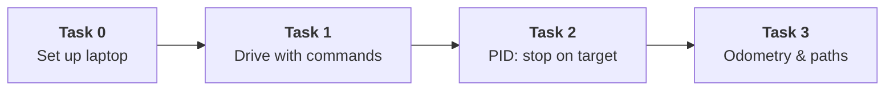

# Romi-Projects: 2027 (Commands v3)

> 📝 **Note:** This uses the **WPILib 2027 alpha**. On WPILib 2026? Use the [main tutorials](../README.md) instead.

Learn to program robots with **Romis** and **WPILib 2027 Commands v3**. No Romi? No problem: every project includes a pretend Romi you can drive in the simulator.

> 💡 **Tip:** Type the short snippets yourself. You'll learn way faster. For whole new files, pasting is fine.

| | Task | You'll make |
|---|---|---|
| 🛠️ | [Task 0: Configuring Computer](Task%200/Instructions.md) | WPILib 2027, Git, the sim window |
| 🕹️ | [Task 1: Drive with Commands](Task%201/Instructions.md) | Joystick driving, "drive 12 in" / "turn 90°" buttons, a square auto |
| 🎯 | [Task 2: PID](Task%202/Instructions.md) | Commands that stop exactly on target, live tuning, a *real* square |
| 🗺️ | [Task 3: Odometry & Paths](Task%203/Instructions.md) | A live map of the Romi, curvy paths, a there-and-back auto |

## What's in here

| Folder | What |
|---|---|
| `Template/` | Starting project. **Copy it** to begin Task 1. |
| `Task N/Instructions.md` | The tutorial |
| `Task N/checkpoints/stepN/` | The code after each step. Compare if you get stuck. |
| `Task N/Solution/` | Finished project for that task |

Having trouble? See the [Troubleshooting Guide](Troubleshooting%20Guide.md).
