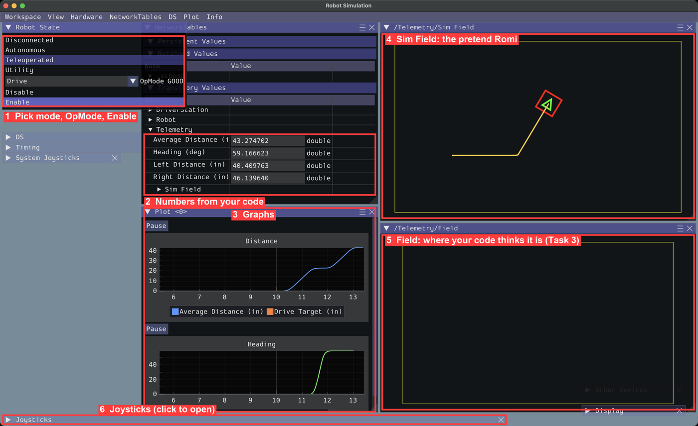

# Task 0: Configuring Computer

## Overview

Bring your own laptop if you can (school laptops are locked down). You need **WPILib VS Code**: plain VS Code is missing the robot tools.

## Downloading WPILib (2027 alpha)

These tutorials use **WPILib 2027** (Commands v3). It's still in **alpha**, so get it from GitHub, not the normal docs page:

1. Go to https://github.com/wpilibsuite/allwpilib/releases and find **v2027.0.0-alpha-7**.
2. Under **Assets**, download the installer for your computer:
   | Computer | File |
   |---|---|
   | Windows | `WPILib_Windows-x64-2027.0.0-alpha-7.iso` |
   | Mac (M1/M2/M3/M4) | `WPILib_macOS-Arm64-2027.0.0-alpha-7.dmg` |
   | Mac (Intel) | `WPILib_macOS-Intel-2027.0.0-alpha-7.dmg` |
   | Linux | `WPILib_Linux-x64-2027.0.0-alpha-7.tar.gz` |

   Needs Windows 11, macOS 15+, or Ubuntu 26.04. **Mac:** run `xcode-select --install` first.
3. Run it and pick **Everything**. It installs next to any older WPILib, so it won't break anything.
4. Open **WPILib VS Code 2027** (not the 2026 one, and not plain VS Code).

> 📝 **Note:** If a newer 2027 alpha/beta is out, ask a mentor before using it. Things can change between versions.

## Downloading & configuring Git
### Windows
If you use a package manager like [winget](https://learn.microsoft.com/en-us/windows/package-manager/) or [chocolatey](https://chocolatey.org/) use those, otherwise go to https://git-scm.com/install/windows and download and run the standalone installer.

### MacOS
If you already have homebrew then use `brew install git`, otherwise use `xcode-select --install` to install the xcode command line tools which comes with git.

### Linux
It's probably already installed (check with `which git`). If not, install `git` with your package manager.

Then set up git. First, go to https://github.com/settings/emails, turn on **Keep my email addresses private**, and copy the email that looks like `12345+username@users.noreply.github.com`. Then run these in a terminal (use your GitHub username and that email):

```sh
git config --global user.name "your-github-username"
git config --global user.email "12345+username@users.noreply.github.com"
git config --global rerere.enabled true
git config --global push.autoSetupRemote true
git config --global pull.rebase true
git config --global rebase.autoStash true
```

## Connecting to the Romis
To connect to the romis, disconnect from your current wi-fi and find the romi's network, the password will be set to `82488248`. If you can't find it, here are some common causes:

- Romi is off
- Romi is out of battery
- You are attempting to connect to the wrong romi
- You have wi-fi disabled
- Your computer just doesn't work
- Someone's already connected to the romi
- Someone (100% not Ibrahim) drove the romi off a table
- Other Reasons (Please ask experienced member)

### Possible fixes
- Turn the romi on (Try both the switch and the button)
- Ask if other people are connected to the romi
- Put batteries/replace the batteries in the romi
- Restart your computer

## Sim interface



| # | Part | What it's for |
|---|---|---|
| 1 | **Robot State** | **Disconnected** (= disabled, nothing moves), **Autonomous** (robot drives itself), **Teleoperated** (you drive). Below: the **OpMode** box and **Enable / Disable**. |
| 2 | **NetworkTables** | Numbers your code sends (distance, heading…) |
| 3 | **Plot** | Graphs of those numbers. Double-click a graph to re-fit it. |
| 4 | **Sim Field** | Map with the pretend Romi and its trail |
| 5 | **Field** | Map of where your code *thinks* the Romi is (Task 3) |
| 6 | **Joysticks** | **Keyboard 0** is already on **Joystick[0]**. Open it to plug in a real controller. |

You'll use these in every task.

## Conventions
### Naming Conventions
On ChainLynx, we use the following naming conventions

```java
// For classes
public class RobotContainer {}

// For objects,
private RomiDrivetrain drivetrain;

// For constants,

public static final double kMaxVelocity = 1.0;

// For class fields,

private double speedMultiplier;
```


### Units
These tutorials put the unit in the name, like `getAverageDistanceInches()`. Later you can use the [Units library](https://docs.wpilib.org/en/stable/docs/software/basic-programming/java-units.html), which stops mix-ups like inches vs meters.
