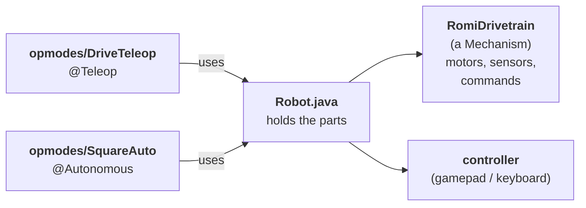
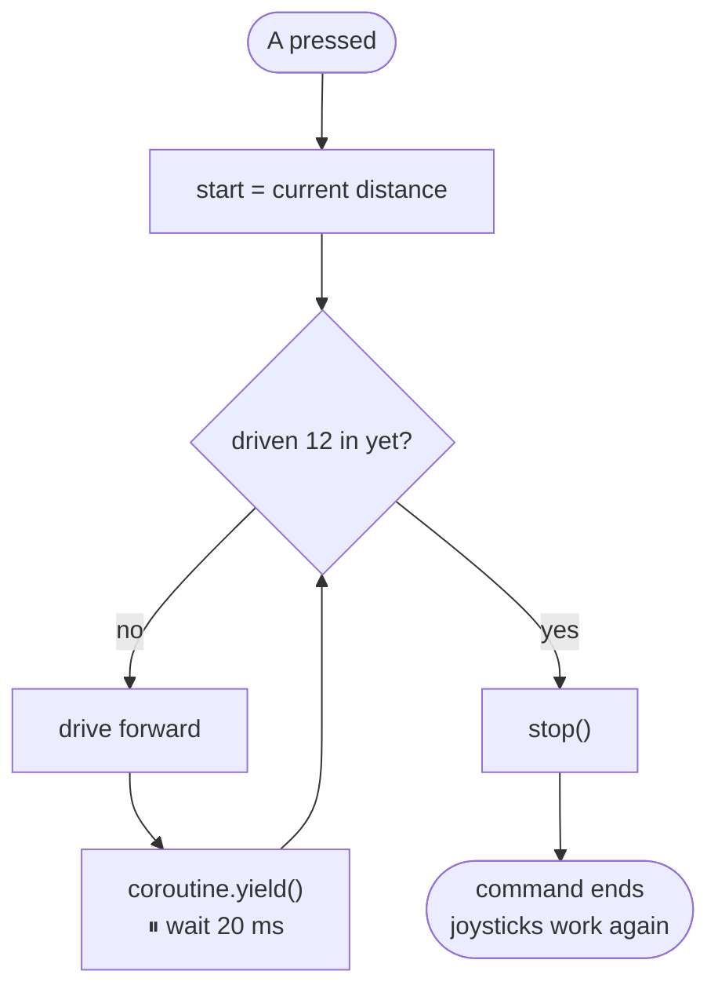
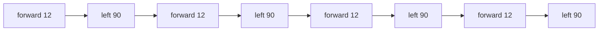

# Task 1: Drive the Romi with Commands

**You'll build:** joystick driving · a "drive 12 inches" button · a "turn 90°" button · measuring and fixing turn overshoot · an autonomous that drives a square.

**Time:** about 1 hour · **Need:** [Task 0](../Task%200/Instructions.md) done. A Romi is optional, because the Template includes a pretend Romi.

> 💡 **Tip:** Type the short snippets yourself. You'll remember them way better. For whole new files, pasting is fine.

> 📝 **Note:** When you add code, VS Code often adds the `import` lines for you. If an import the lesson shows is already there, skip it.

> Stuck? Each step has a finished copy in [`checkpoints/`](checkpoints).

---

## How the code fits together



| Word | Means |
|---|---|
| **Mechanism** | A part of the robot (like the drivetrain). Only **one command** can use it at a time. |
| **Command** | Something the robot does ("drive 12 inches"). |
| **OpMode** | A mode you pick in the sim window, like **Drive** (Teleop) or **Square** (Autonomous). |

---

## Step 1: Run the Template

1. Copy the **`Template`** folder (put the copy right next to it) and rename the copy to **`MyRomi`**.
2. WPILib VS Code → **File → Open Folder** → `MyRomi`.
3. Click the  (top right) → **Simulate Robot Code** (if it asks, tick **Sim GUI**). The first time takes a minute or two.
4. To stop: close the sim window (red ● on Mac, ✕ on Windows). Stopping only in VS Code leaves the window open.

> ### ✅ Checkpoint 1
> The sim window opens with a map (**Sim Field**) showing the pretend Romi. In **NetworkTables → Telemetry**, **Left/Right Distance (in)** are `0`.
>
> 
>
> Map missing? Menu **NetworkTables → Telemetry → Sim Field**.

<details>
<summary>🤖 Using a real Romi instead?</summary>

1. At the top of `build.gradle` (just below `plugins`), set `def useRealRomi = true`.
2. Turn the Romi on and connect your laptop to its WiFi (`Romi1` / `Romi2`, password `82488248`).
3. **Simulate Robot Code** like normal. Your code runs on the laptop and talks to the Romi over WiFi.

**Sim Field** now shows a 👻 **ghost**: where the sim *predicts* your Romi should be. Watch the real Romi and the ghost side by side. Where do they drift apart? (Real motors, slippery wheels, and battery level don't match the sim exactly.)

Back to sim-only? Set `useRealRomi = false`.

</details>

---

## Step 2: Drive with a controller

### 2a. Add the controller to `Robot.java`

All the code is in **`src/main/java/frc/robot/`**.

```java
import org.wpilib.command3.button.CommandGamepad; // 👈 add at the top with the other imports
```

```java
  // ---- Mechanisms ----
  public final RomiDrivetrain drivetrain = new RomiDrivetrain();

  // ---- Controllers ----                                       👈 add
  public final CommandGamepad controller = new CommandGamepad(0); // 👈 add
```

### 2b. Add a drive command to `mechanisms/RomiDrivetrain.java`

```java
import java.util.function.DoubleSupplier;    // 👈 add this import
```

Add this **above** `logTelemetry()`:

```java
  // ---- Commands ----

  /** Drives with the joysticks. Runs forever (until another command takes over). */
  public Command driveWithJoysticks(DoubleSupplier forward, DoubleSupplier rotation) {
    return runRepeatedly(() -> arcadeDrive(forward.getAsDouble(), rotation.getAsDouble()))
        .named("Joystick Drive");
  }
```

| Part | Means |
|---|---|
| `runRepeatedly(...)` | Run this code every 20 ms, forever |
| `() -> ...` | A *lambda*: code you hand over to run later |
| `DoubleSupplier` | Something that gives a fresh number every time you ask (the joystick) |
| `.named("...")` | Every command **must** have a name. You'll see it in the sim window. |

### 2c. Make a Teleop OpMode

Click **`Robot.java`** in the Explorer (the file list on the left), then click the **New File** icon at the top of the Explorer and type **`opmodes/DriveTeleop.java`** (this makes the `opmodes` folder too). Press **Enter**.

VS Code fills the new file with starter code: press **⌘A** (Mac) / **Ctrl+A** (Windows) to select it all, then paste this over it:

```java
package frc.robot.opmodes;

import frc.robot.Robot;
import org.wpilib.opmode.OpMode;
import org.wpilib.opmode.Teleop;

/** Shows up as "Drive" in the Teleop list of the sim window. */
@Teleop(name = "Drive")
public class DriveTeleop implements OpMode {
  public DriveTeleop(Robot robot) {
    var drivetrain = robot.drivetrain;
    var controller = robot.controller;

    // Joysticks are backwards (pushing up gives a negative number), so flip them with "-"
    drivetrain.setDefaultCommand(
        drivetrain.driveWithJoysticks(
            () -> -controller.getLeftY(), () -> -controller.getRightX()));
  }
}
```

**Default command** = what the drivetrain does when no other command is using it.

> ### ✅ Checkpoint 2
> 1. **Simulate Robot Code**.
> 2. In **Robot State**: click **Teleoperated** → pick **Drive** in the OpMode box → click **Enable**.
> 3. Drive with the keyboard:
>
> | Key | Does |
> |---|---|
> | **W** / **S** | forward / back |
> | **E** / **R** | turn left / right |
>
> The Romi drives around **Sim Field**, and **Left/Right Distance** change.
>
> The **trail** shows where it drove.
>
> 
>
> Got a real controller? Open **System Joysticks** and **Joysticks** (left side / bottom) and drag it onto **Joystick[0]**. Left stick drives, right stick turns.

---

## Step 3: A "drive 12 inches" button



### 3a. In `RomiDrivetrain.java`, add an average distance (below `getRightDistanceInches()`)

```java
  public double getAverageDistanceInches() {
    return (getLeftDistanceInches() + getRightDistanceInches()) / 2;
  }
```

### 3b. Add the command (below `driveWithJoysticks`)

```java
  /** Drives forward a distance, then stops. */
  public Command driveForward(double inches) {
    return run(coroutine -> {
          double start = getAverageDistanceInches();

          while (getAverageDistanceInches() - start < inches) {
            arcadeDrive(kDefaultDriveSpeed, 0);
            coroutine.yield(); // wait 20 ms, let everything else run, then keep going
          }

          stop();
        })
        .named("Drive Forward");
  }
```

| Part | Means |
|---|---|
| `run(coroutine -> { ... })` | Runs your code **once, top to bottom**, like a normal method |
| `coroutine.yield()` | Pause here until the next 20 ms tick, then keep going |

> ⚠️ **Important:** **Always `coroutine.yield()` inside a loop.** Without it the loop never lets the rest of the robot run, and everything freezes.

### 3c. Show it in the sim window (inside `logTelemetry()`)

```java
    Telemetry.log("Average Distance (in)", getAverageDistanceInches()); // 👈 add
```

### 3d. Bind it to the A button (in `DriveTeleop.java`, after `setDefaultCommand(...)`)

```java
    // A button (Z on the keyboard): drive forward 12 inches
    controller.faceDown().onTrue(drivetrain.driveForward(12));
```

> ### ✅ Checkpoint 3
> **Teleoperated** → **Drive** → **Enable** → press **Z** (or **A**).
>
> The Romi drives forward by itself and stops. **Average Distance** goes up by about **12–13**. Then W/S work again.
>
> 

---

## Step 4: A "turn 90°" button

### 4a. Add the gyro to `RomiDrivetrain.java`

```java
import org.wpilib.romi.RomiGyro; // 👈 add import
```

```java
  // The gyro measures how far the Romi has turned          👈 add above diffDrive
  private final RomiGyro gyro = new RomiGyro();
```

Add this method (above `// ---- Commands ----`):

```java
  /** Counter-clockwise (turning left) is positive. */
  public double getHeadingDegrees() {
    return -gyro.getAngleZ(); // the Romi's gyro counts clockwise as positive, so flip it
  }
```

Why the `-`? WPILib says left is positive; the Romi's gyro counts the other way, so we flip it.

### 4b. Add the command (below `driveForward`)

```java
  /** Turns left (counter-clockwise) some degrees, then stops. */
  public Command turnLeft(double degrees) {
    return run(coroutine -> {
          double start = getHeadingDegrees();

          while (getHeadingDegrees() - start < degrees) {
            arcadeDrive(0, kDefaultRotSpeed);
            coroutine.yield();
          }

          stop();
        })
        .named("Turn Left");
  }
```

### 4c. Show the heading (inside `logTelemetry()`)

```java
    Telemetry.log("Heading (deg)", getHeadingDegrees()); // 👈 add
```

### 4d. Bind it to B (in `DriveTeleop.java`, under the A-button line)

```java
    // B button (X on the keyboard): turn left 90 degrees
    controller.faceRight().onTrue(drivetrain.turnLeft(90));
```

> ### ✅ Checkpoint 4
> Press **X** (or **B**). The Romi turns left and stops. **Heading** goes up by about **98** (a real Romi may go to ~110–120).
>
> 🤔 It turns a bit *too far*. Why? The gyro reading arrives a moment late, so by the time your code sees 90° and says stop, the Romi has already turned farther. You'll fix this next.
>
> 🤖 **Real Romi:** turn left with **E**. **Heading** should go *up*. If it goes down, check the `-` in `getHeadingDegrees()`.

---

## Step 5: Measure and fix the overshoot

Real engineers fix problems by **measuring** them. Let's measure how far the turn overshoots, then stop that much early.

### 5a. Measure

Press **X** three times and write down how much **Heading** goes up each time. Then:

> **overshoot** = (how much Heading went up) − 90

In the sim it's about **8**. (Real Romi: about 20.)

### 5b. Add your number to `Constants.java` (inside `DriveConstants`, under `kDefaultRotSpeed`)

```java
    // Turns overshoot because of delay. Measure: (how much Heading went up) - 90
    public static final double kTurnStopEarlyDegrees = 8;
```

Use **your** measured number.

### 5c. Stop early (in `turnLeft`, change the `while` line)

```java
          while (getHeadingDegrees() - start < degrees - kTurnStopEarlyDegrees) {
```

> ### ✅ Checkpoint 5
> Restart the sim → **Teleoperated** → **Drive** → **Enable** → press **X** three times. Each turn is now about **90**. 🎯
>
> 🤔 Try `kDefaultRotSpeed = 0.35` (restart the sim): it overshoots again (~97). Stop-early only fits one speed. Put it back to `0.2`; Task 2 fixes this for good.

---

## Step 6: Autonomous square

Commands can **wait for other commands**. `coroutine.await(...)` = "run this command and wait until it's done".

OpMode code runs at two times: the **constructor** runs when you *pick* the mode, and **`start()`** runs when you press *Enable*.



New file **`opmodes/SquareAuto.java`** (like Step 2c: click a file in `opmodes`, **New File** icon, then select all and replace):

```java
package frc.robot.opmodes;

import frc.robot.Robot;
import org.wpilib.command3.Command;
import org.wpilib.command3.Scheduler;
import org.wpilib.opmode.Autonomous;
import org.wpilib.opmode.OpMode;

/** Shows up as "Square" in the Autonomous list of the sim window. */
@Autonomous(name = "Square")
public class SquareAuto implements OpMode {
  private final Robot robot;

  public SquareAuto(Robot robot) {
    this.robot = robot;
  }

  /** Runs once when the robot is enabled. */
  @Override
  public void start() {
    var drivetrain = robot.drivetrain;

    Command square =
        Command.noRequirements(coroutine -> {
              for (int side = 0; side < 4; side++) {
                coroutine.await(drivetrain.driveForward(12)); // run it and wait until it's done
                coroutine.await(drivetrain.turnLeft(90));
              }
            })
            .named("Square");

    Scheduler.getDefault().schedule(square);
  }
}
```

| Part | Means |
|---|---|
| `Command.noRequirements(...)` | A command that doesn't use a mechanism itself. The commands it `await`s do. |
| `Scheduler.getDefault().schedule(...)` | "Start running this command" |

> ### ✅ Checkpoint 6
> **Disable** → click **Autonomous** → pick **Square** in the OpMode box → **Enable**.
>
> The **trail** draws a square. Turns look good now 🎯, but **Average Distance** ends near **51**, not 48: `driveForward` overshoots too. Task 2 fixes both.
>
> 

---

## 🎉 Done!

| You learned | Code |
|---|---|
| Mechanisms own the hardware | `implements Mechanism` (top of `RomiDrivetrain.java`) |
| Commands that run forever | `runRepeatedly(...)` |
| Commands with steps and loops | `run(coroutine -> { ... coroutine.yield(); })` |
| Running commands in order | `coroutine.await(...)` |
| Buttons | `controller.faceDown().onTrue(...)` |
| Teleop / Autonomous modes | `@Teleop`, `@Autonomous` |
| Measure, then fix | `kTurnStopEarlyDegrees` |

### Challenges (optional)
Answers (tested in the sim) are in [`challenges/`](challenges) — try first!

- Add a **`driveBackward(inches)`** command and put it on the **Y** button (**V** key, `faceUp()`). Hint: copy `driveForward`, flip the speed to `-kDefaultDriveSpeed`, and loop while `start - distance < inches`.
- Make a **Big Square** auto with 24-inch sides. (Hint: copy `SquareAuto`, change the name and the 12.)
- Make a **Triangle** auto: 3 sides, 120° turns. Does your stop-early number still work for bigger turns?

**Next:** [Task 2: PID](../Task%202/Instructions.md)

<details>
<summary>❌ Something's wrong?</summary>

| Problem | Fix |
|---|---|
| Red squiggles under a word | Missing `import`. Hover → **Quick Fix** → pick the `org.wpilib...` one. |
| **Drive** isn't in the OpMode list | The file must be inside `frc/robot/opmodes`, and the class must be `public` with `@Teleop`. |
| Keys do nothing | Click on the sim window first. Open **Joysticks** (bottom): **Keyboard 0** should be on **Joystick[0]**. |
| Pressing Z does nothing | Did you add the `onTrue(...)` line? Are you in **Teleoperated → Drive** and **enabled**? |
| Everything froze | A `while` loop is missing `coroutine.yield();` |
| Romi doesn't move on Sim Field | Is the robot **enabled**? (With a real Romi, Sim Field shows the ghost, so it only moves while your code drives.) |

</details>
