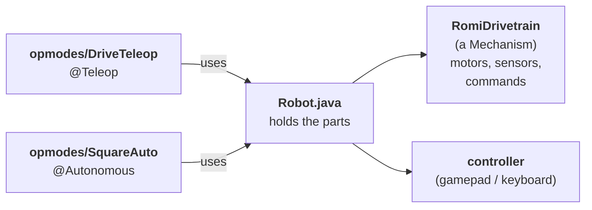
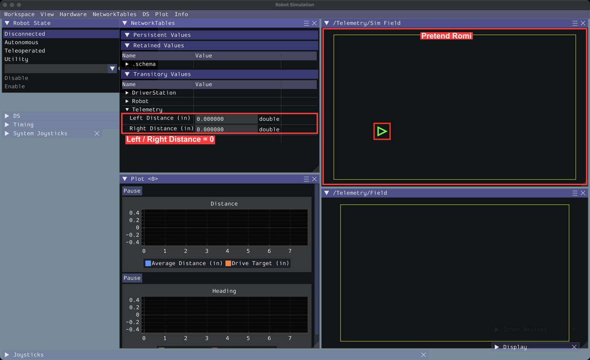
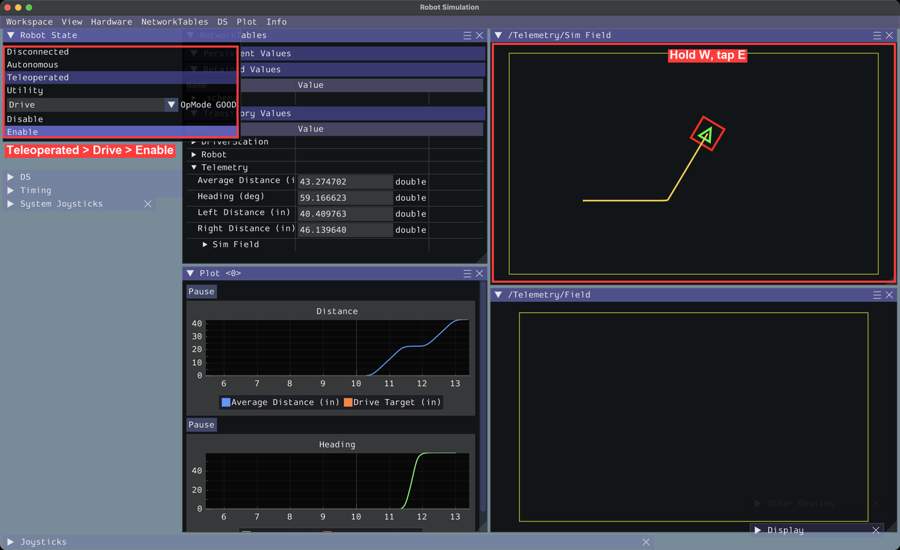
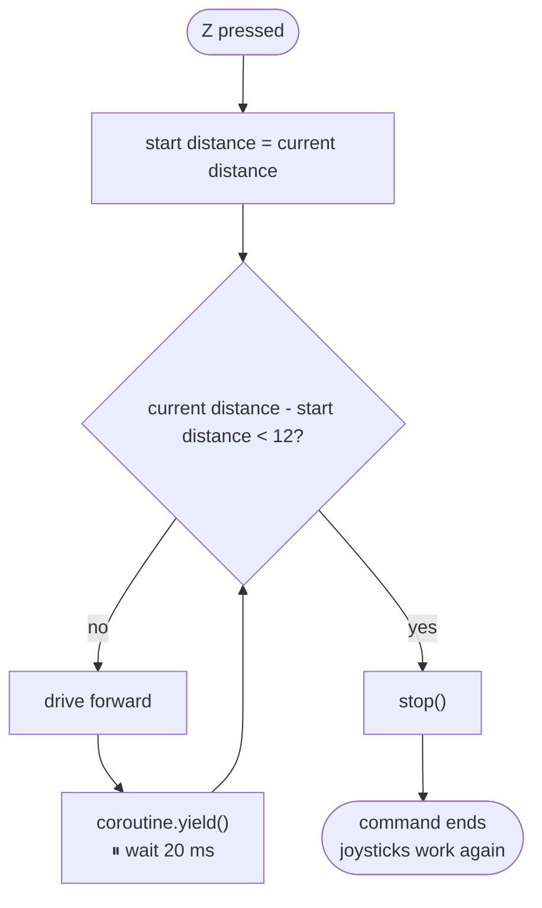
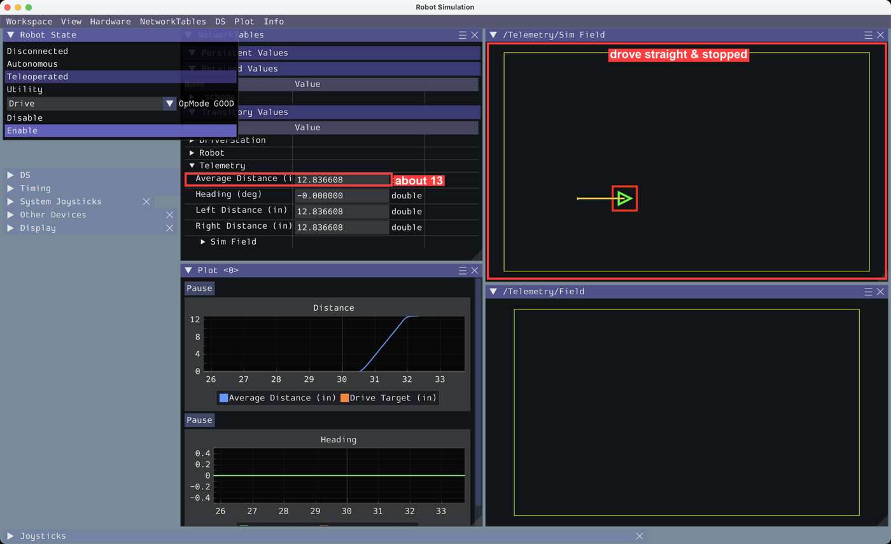
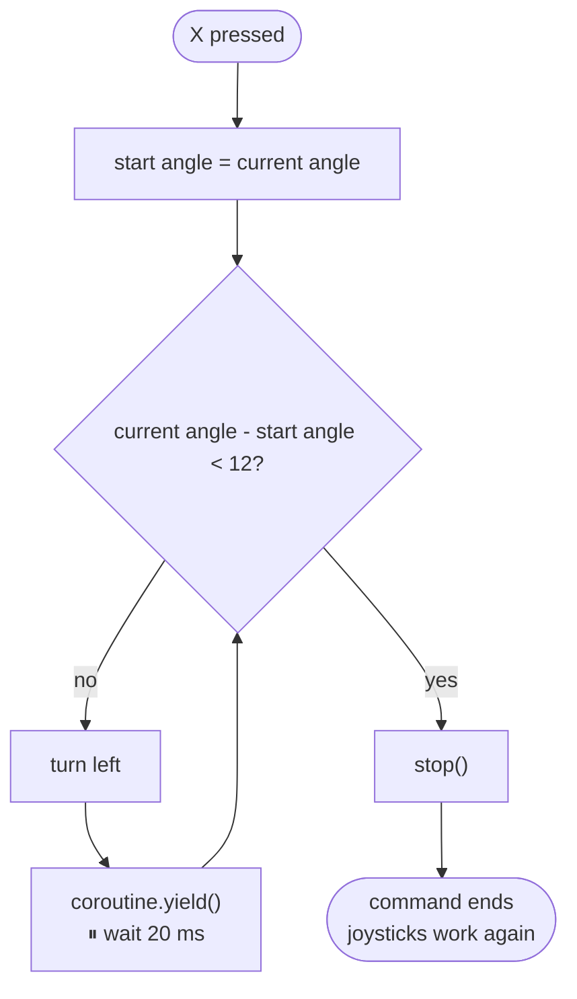
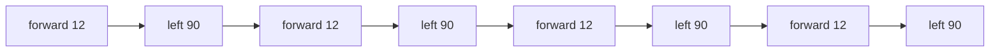
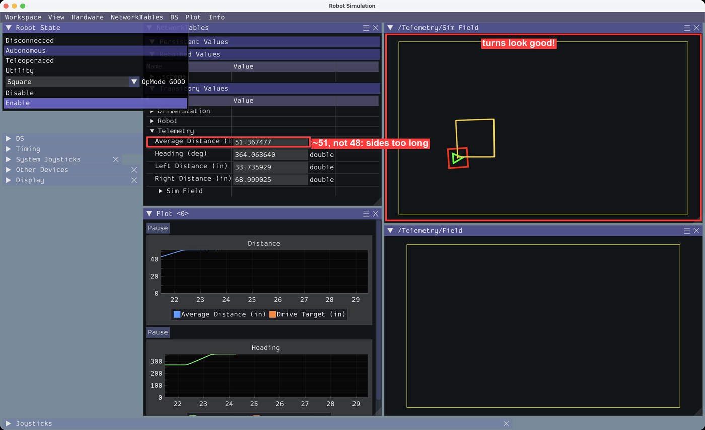

# Task 1: Drive the Romi with Commands

**You'll build:** joystick driving · a "drive 12 inches" button · a "turn 90°" button · measuring and fixing turn overshoot · an autonomous that drives a square.

**Time:** about 1 hour · **Need:** [Task 0](../Task%200/Instructions.md) done. A Romi is optional, because the Template includes a pretend Romi.

> [!TIP] 
Stuck? Each step has a finished copy in [`checkpoints/`](checkpoints).

---

## How the code fits together



| Word          | Means                                                                                 |
| ------------- | ------------------------------------------------------------------------------------- |
| **Command**   | Something the robot can do ("drive 12 inches").                                       |
| **Mechanism** | A part of the robot (like the drivetrain). Only **one command** can use it at a time. |
| **OpMode**    | Config that defines how the robot should behave. Can be teleoperated or autonomous.   |

>[!NOTE]
More information is available at: https://docs.wpilib.org/en/latest/docs/software/commandbased/commands-v3/index.html 

---

## Step 1: Run the Template

1. Copy the **`Template`** folder (put the copy right next to it) and rename the copy to **`MyRomi`**.
2. WPILib VS Code → **File → Open Folder** → `MyRomi`.
3. Click the  (top right) → **Simulate Robot Code** (if it asks, tick **Sim GUI**). The first time takes a minute or two.
4. To stop close the sim window.
<details>
<summary> 5. Additional Instructions for using a Real Romi </summary>

1. At the top of `build.gradle` (just below `plugins`), set `def useRealRomi = true`.
2. Turn the Romi on and connect your laptop to its WiFi (`Romi1` / `Romi2`, password `82488248`).
3. **Simulate Robot Code** like normal. Your code runs on the laptop and talks to the Romi over WiFi.

**Sim Field** now shows a ghost: where the sim *predicts* your Romi should be. Watch the real Romi and the ghost side by side. Where do they drift apart? (Real motors, slippery wheels, and battery level don't match the sim exactly.)

Back to sim-only? Set `useRealRomi = false`.

</details>  <br>

>[!TIP]
Don't want to click  all the time? Use `Ctrl/Cmd + SHIFT + P`


> ### Checkpoint 1
> The sim window opens with a map (**Sim Field**) showing the pretend Romi. In **NetworkTables → Telemetry**, **Left/Right Distance (in)** are 0.
>
> 
>
> Map missing? Menu **NetworkTables → Telemetry → Sim Field**.
---

## Step 2: Drive with a controller/keyboard


### 2a. Add the controller to `Robot.java`

All the code is in **`src/main/java/frc/robot/`**.

>[!TIP]
VSCode will give suggestions as you type. If you take a suggestion that needs an `import` using the enter key, it will add the `import` lines for you.


```java
  import org.wpilib.command3.button.CommandGamepad; // add at the top 

  // ---- Mechanisms ----
  public final RomiDrivetrain drivetrain = new RomiDrivetrain();

  // ---- Controllers ----                                      
  public final CommandGamepad controller = new CommandGamepad(0); 
```

### 2b. Add a drive command to `mechanisms/RomiDrivetrain.java`

Get started by adding the following code. Complete the `driveWithJoysticks` command by following the example given in `exampleCommand`.

```java
  import java.util.function.DoubleSupplier; // add at the top 

  // Add this **above** `logTelemetry()`:
  // ---- Commands ----
  public Command exampleCommand(DoubleSupplier supplier) {
    return runRepeated(() -> System.out.println("Got " + supplier.getAsDouble() + " from the DoubleSupplier.")).named("Example Command");
  }

  /** Drives with the joysticks. Runs forever (until another command takes over). */
  public Command driveWithJoysticks(DoubleSupplier forward, DoubleSupplier rotation) {
    // Use runRepeatedly with a lambda that calls arcadeDrive with the latest values from both suppliers.
    // Name the command "Drive With Joysticks"
  }
```


| Part                 | Means                                                                                                              |
| -------------------- | ------------------------------------------------------------------------------------------------------------------ |
| `runRepeatedly(...)` | Run this code every 20 ms, forever                                                                                 |
| `() -> ...`          | A *lambda function*: A reusable piece of code that can be run later.                                               |
| `DoubleSupplier`     | Something that gives a number every time you ask (i.e., the controller)                                            |
| `.named("...")`      | Every command **must** have a name. You'll see it in the sim window or in an error if something goes wrong inside. | , |

>[!TIP]
Need a multiline lambda? Add braces! Like so:
```java
() -> {
  // Do some stuff.
}
```

### 2c. Make a Teleop OpMode

Click **`Robot.java`** in the Explorer (the file list on the left), then click the **New File** icon at the top of the Explorer and type **`opmodes/DriveTeleop.java`** (this makes the `opmodes` folder too). Press **Enter**.

VS Code fills the new file with starter code: press **⌘A** (Mac) / **Ctrl+A** (Windows) to select it all, then paste this over it:

```java
package frc.robot.opmodes;

import frc.robot.Robot;
import org.wpilib.opmode.OpMode;
import org.wpilib.opmode.Teleop;

/** Shows up as "Drive" in the Teleop list of the sim window. */
@Teleop(name = "Drive")
public class DriveTeleop implements OpMode {
  public DriveTeleop(Robot robot) {
    var drivetrain = robot.drivetrain;
    var controller = robot.controller;

    // Joysticks are backwards (pushing up gives a negative number), so flip them with "-"
    drivetrain.setDefaultCommand(
        drivetrain.driveWithJoysticks(
            () -> -controller.getLeftY(), () -> -controller.getRightX()));
  }
}
```

**Default command** = what the drivetrain does when no other command is using it.

> ### ✅ Checkpoint 2
> 1. **Simulate Robot Code**.
> 2. In **Robot State**: click **Teleoperated** → pick **Drive** in the OpMode box → click **Enable**.
> 3. Drive with the keyboard:
>
> | Key | Does |
> |---|---|
> | **W** / **S** | forward / back |
> | **E** / **R** | turn left / right |
>
> The Romi drives around **Sim Field**, and **Left/Right Distance** change.
>
> The **trail** shows where it drove.
>
> 
>
> Got a real controller? Open **System Joysticks** and **Joysticks** (left side / bottom) and drag it onto **Joystick[0]**. Left stick drives, right stick turns.

---

## Step 3: A "drive 12 inches" button

Sometimes, we need to have the robot perform some actions autonomously. Let's make the "Z" button on the keyboard cause the robot to drive 12 inches forward. We can visualize the logic the robot follows using the following flowchart.



### 3a. In `RomiDrivetrain.java`, add an average distance (below `getRightDistanceInches()`)

```java
  public double getAverageDistanceInches() {
    // Return the average of the left and right distance in inches.
  }
```

### 3b. Add the command (below `driveWithJoysticks`)

```java
  /** Drives forward a distance, then stops. */
  public Command driveForward(double inches) {
    return run(coroutine -> {
          // 1. Get the starting distance reading using getAverageDistanceInches()

          // 2. Use a "while" loop to repeatedly move forward using arcadeDrive() with speed kDefaultDriveSpeed while we haven't moved 12 inches.
          // Hint: to see how far you've driven, subtract the current value of getAverageDistanceInches() with the starting value you got in step 1.
          while () {

            coroutine.yield(); // let other commands run. DO NOT DELETE.
          }

          // 3. Stop the motors using stop()
        })
        .named("Drive Forward");
  }
```

| Part                        | Means                                                                                                                                 |
| --------------------------- | ------------------------------------------------------------------------------------------------------------------------------------- |
| `run(coroutine -> { ... })` | Runs your code **once, top to bottom**, like a normal method                                                                          |
| `coroutine.yield()`         | Pause this command here and hand control back to the scheduler. It can run other scheduled work, then resume this command later.      |
| Scheduler                   | Manages which commands should run and when. Tries to give each command a chance to run every 20 ms, but slow commands can hold it up. |

>[!NOTE]
> The Scheduler schedules commands *cooperatively*. This means that commands take turns running. A command tells the Scheduler its turn is done with `coroutine.yield()`. The scheduler tries to give each command a turn every 20 ms, but if some commands take a long time (they do too much before using `coroutine.yield()`) it can hold up the Scheduler. Most commands that you write should finish quickly so that other commands get a chance to run and the Scheduler can keep everything running on time.

>[!WARNING]
> **Always `coroutine.yield()` inside a loop.** Without it the loop never lets other cod run, and everything freezes. This can be very dangerous, especially if the robot is moving.

### 3c. Show it in the sim window (inside `logTelemetry()`)

```java
    Telemetry.log("Average Distance (in)", getAverageDistanceInches());
```

### 3d. Bind it to the A button (in `DriveTeleop.java`, after `setDefaultCommand(...)`)

Now that we have our command, we need to bind it to a button so that we can *trigger* it. 

```java
    // Z button on the keyboard: drive forward 12 inches
    controller.faceDown().onTrue(drivetrain.driveForward(12));
```

> ### ✅ Checkpoint 3
> **Teleoperated** → **Drive** → **Enable** → press **Z** (or **A**).
>
> The Romi drives forward by itself and stops. **Average Distance** goes up by about **12** (the robot may move a little even after the motors stop due to inertia). Then the W/S controls work again.
>
> 

---

## Step 4: A "turn 90°" button

Now let's add a command to turn 90°. It's very similar to the `driveForward()` command, as you can see from the flowchart below.



### 4a. Add the gyro to `RomiDrivetrain.java`

A gyroscope is a type of device that measures rotation. We call it a "gyro" short (not to be confused with the greek street food). 

First import the Romi's gyroscope code at the top of the `RomiDrivetrain.java` file.

```java
import org.wpilib.romi.RomiGyro;
```

Then we must tell the robot the gyroscope is part of the drivetrain by adding the following line above `diffDrive()`.

```java
  private final RomiGyro gyro = new RomiGyro();
```

Now let's add a function that gets the current heading of the robot in degrees. This tells us, relative to the robots starting direction, the angle it is pointed so that we know which way it's facing. The gyroscope counts clockwise as positive, but we typically want counter-clockwise as positive, so we'll just reverse it with a minus sign.

Add this method (above `// ---- Commands ----`):

```java
  public double getHeadingDegrees() {
    return -gyro.getAngleZ();
  }
```

### 4b. Add the command (below `driveForward`)

```java
  /** Turns left (counter-clockwise) some degrees, then stops. */
  public Command turnLeft(double degrees) {
    return run(coroutine -> {
          // 1. Get the starting heading reading using getHeadingDegrees()

          // 2. Use a "while" loop to repeatedly rturn left using arcadeDrive() with speed kDefaultRotSpeed while we haven't turned 90°.
          // Hint: to see how far you've turned, subtract the current value of getHeadingDegrees() with the starting value you got in step 1.
          while () {

            coroutine.yield();
          }

          // 3. Stop the motors using stop()
        })
        .named("Turn Left");
  }
```

>[!TIP]
> Check your code on a real (or simulated) Romi. Turn left with using the keyboard controls using **E**. You should see `Heading` should go up when you turn left. If it goes down, check the `-` in `getHeadingDegrees()`.

### 4c. Show the heading (inside `logTelemetry()`)

```java
    Telemetry.log("Heading (deg)", getHeadingDegrees()); 
```

### 4d. Bind it to the keyboard's X button (in `DriveTeleop.java`, under the Z-button line)

```java
    // X on the keyboard: turn left 90 degrees
    controller.faceRight().onTrue(drivetrain.turnLeft(90));
```

> ### ✅ Checkpoint 4
Press **X** (or **B**). The Romi should turn left and then stops. Your `Heading` should go goes up by about **98** on a simulated Romi and ~110–120 on a real Romi. Just like driving forward, the robot is still moving when you turn the motors off, so it can't stop instantly.

Let's try to fix these problems next.

---

## Step 5: Measure and fix the overshoot in `turnLeft()`

The problem: the robot moves too far if we stop at the point where we want it to stop because it can't stop instantly.

Solution: Stop the robot before it needs to stop.

How early should we stop it? We can see by measuring how far the turn overshoots, then stop that much earlier. Many motion problems on the robot can be solved by *calibration* like this. 

### 5a. Measure

Press **X** then write down how much **Heading** overshoots by each time. Repeat this process 3 times and take the average.

> **overshoot** = (how much Heading went up) − 90

In the sim it's about **8**. (Real Romi: about 20.)

### 5b. Add your number to `Constants.java` (inside `DriveConstants`, under `kDefaultRotSpeed`)

```java
    // Turns overshoot because of delay. Measure: (how much Heading went up) - 90
    public static final double kTurnStopEarlyDegrees = 8;
```

Use **your** measured number.

### 5c. Stop early (in `turnLeft`, change the `while` line)

```java
          while (getHeadingDegrees() - start < degrees - kTurnStopEarlyDegrees) {
```

>[!NOTE]
> This is not a perfect solution and you should still expect some overshoot due to variations in the precise time the motor stops (remember that each command is run every 20 ms, so there is some room for variation in the exact point the stop() command is called).

## Step 6: Measure and fix the overshoot in `driveForward()`

Now it's your turn. Try and apply what you learned to see if you can improve the overshoot in `driveForward()`.


>### ✅ Checkpoint 5
>Restart the sim → **Teleoperated** → **Drive** → **Enable** → press **X** three times. Each turn is now about **90**. What happens if we change the speed?
>
>Change `kDefaultRotSpeed = 0.35` and restart the sim. It overshoots again (~97). Stop-early only fits one speed because faster speeds need to stop earlier. Slower speeds likewise need to stop a little later. Put it back to `0.2`; Task 2 fixes this for good.

>[!TIP]
You stop faster when you're moving slower (go figure). If you set your default speed lower, you should see less overshoot at the start. Try `kDefaultRotSpeed = 0.035`. It will turn very slowly (~10x slower in fact), but should also overshoot by much less. Sometimes this is good enough! The same should be true for `kDefaultDriveSpeed`.


---

## Step 6: Autonomous square

Commands can also wait for other commands. `coroutine.await(...)` means "run this command and wait until it's done". Let's use this to make an autonomous command that makes the robot move in a square.



New file **`opmodes/SquareAuto.java`** (like Step 2c: click a file in `opmodes`, **New File** icon, then select all and replace):

```java
package frc.robot.opmodes;

import frc.robot.Robot;
import org.wpilib.command3.Command;
import org.wpilib.command3.Scheduler;
import org.wpilib.opmode.Autonomous;
import org.wpilib.opmode.OpMode;

/** Shows up as "Square" in the Autonomous list of the sim window. */
@Autonomous(name = "Square")
public class SquareAuto implements OpMode {
  private final Robot robot;

  public SquareAuto(Robot robot) {
    this.robot = robot;
  }

  /** Runs once when the robot is enabled. */
  @Override
  public void start() {

    var square = Command.noRequirements(coroutine -> {
      // 1. Use coroutine.await() to driveForward(12)
      // 2. Use coroutine.await() to turnLeft(90)
      // Repeat 3 more times.
    }).named("Square");

    Scheduler.getDefault().schedule(square);
  }
}
```

>[!NOTE]
> The commands you made earlier in the drivetrain can be accessed via `robot`. The drivetrain is part of the robot, so we can use `robot.drivetrain.driveForward()`  and `robot.drivetrain.turnLeft()` to access the commands you previously created.

>[!TIP]
> Instead of copying and pasting the code 4 times, try use a `for` loop.

| Part                                   | Means                                                                       |
| -------------------------------------- | --------------------------------------------------------------------------- |
| `Command.noRequirements(...)`          | A command that doesn't use a mechanism itself. The commands it `await`s do. |
| `Scheduler.getDefault().schedule(...)` | "Start running this command"                                                |

> ### ✅ Checkpoint 6
> **Disable** → click **Autonomous** → pick **Square** in the OpMode box → **Enable**.
>
> The **trail** draws a square. Depending on how well **Average Distance** ends near **51**, not 48: `driveForward` overshoots too. Task 2 fixes both.
>
> 

---

>[!NOTE]
> OpMode code runs at two times: the **constructor** runs when you *pick* the mode, and **`start()`** runs when you press *Enable*.
---
## End of Task 1

| You learned                   | Code                                                  |
| ----------------------------- | ----------------------------------------------------- |
| Mechanisms own the hardware   | `implements Mechanism` (top of `RomiDrivetrain.java`) |
| Commands that run forever     | `runRepeatedly(...)`                                  |
| Commands with steps and loops | `run(coroutine -> { ... coroutine.yield(); })`        |
| Running commands in order     | `coroutine.await(...)`                                |
| Buttons                       | `controller.faceDown().onTrue(...)`                   |
| Teleop / Autonomous modes     | `@Teleop`, `@Autonomous`                              |
| Measure, then fix             | `kTurnStopEarlyDegrees`                               |

### Challenges (optional)
Answers (tested in the sim) are in [`challenges/`](challenges) — try first!

- Add a **`driveBackward(inches)`** command and put it on the **Y** button (**V** key, `faceUp()`). Hint: copy `driveForward`, flip the speed to `-kDefaultDriveSpeed`, and loop while `start - distance < inches`.
- Make a **Big Square** auto with 24-inch sides. (Hint: copy `SquareAuto`, change the name and the 12.)
- Make a **Triangle** auto: 3 sides, 120° turns. Does your stop-early number still work for bigger turns?

**Next:** [Task 2: PID](../Task%202/Instructions.md)

<details>
<summary>❌ Something's wrong?</summary>

| Problem                            | Fix                                                                                                               |
| ---------------------------------- | ----------------------------------------------------------------------------------------------------------------- |
| Red squiggles under a word         | Missing `import`. Hover → **Quick Fix** → pick the `org.wpilib...` one.                                           |
| **Drive** isn't in the OpMode list | The file must be inside `frc/robot/opmodes`, and the class must be `public` with `@Teleop`.                       |
| Keys do nothing                    | Click on the sim window first. Open **Joysticks** (bottom): **Keyboard 0** should be on **Joystick[0]**.          |
| Pressing Z does nothing            | Did you add the `onTrue(...)` line? Are you in **Teleoperated → Drive** and **enabled**?                          |
| Everything froze                   | A `while` loop is missing `coroutine.yield();`                                                                    |
| Romi doesn't move on Sim Field     | Is the robot **enabled**? (With a real Romi, Sim Field shows the ghost, so it only moves while your code drives.) |

</details>
