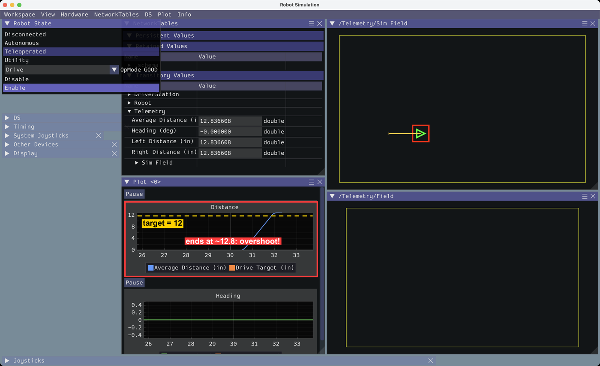
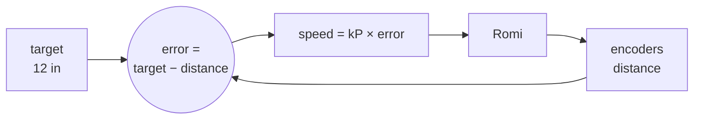
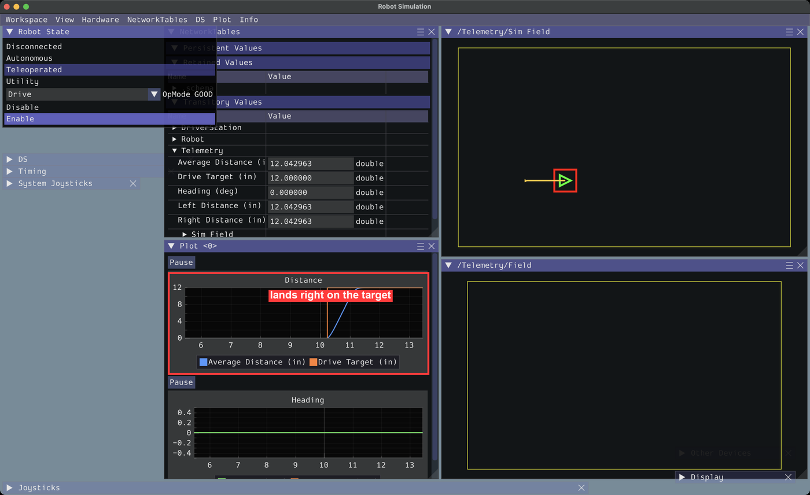
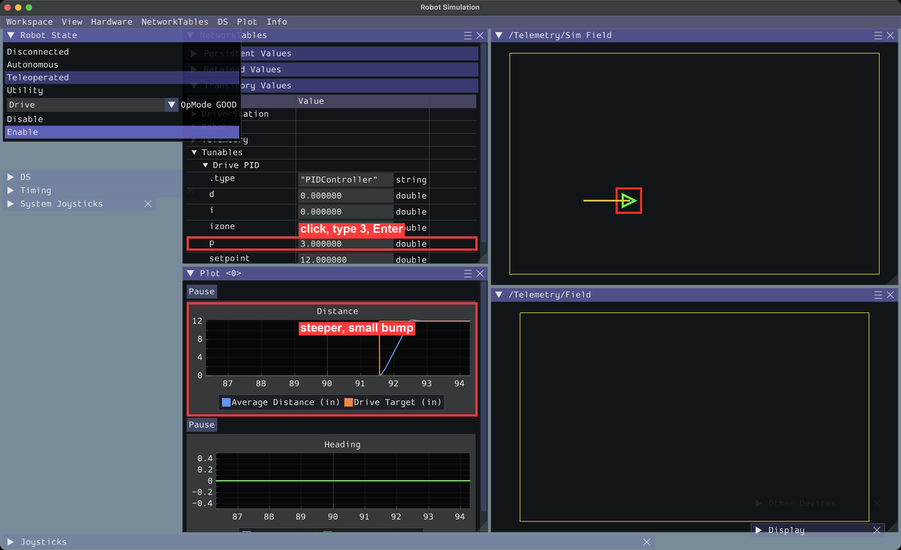
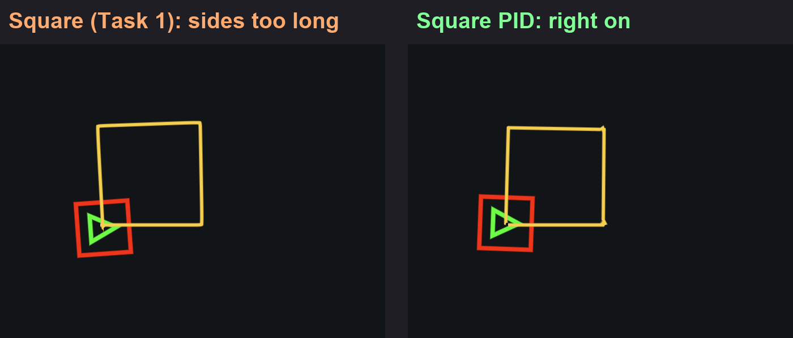

# Task 2: PID (Stop Right on Target)

**You'll build:** drive and turn commands that slow down and stop *exactly* on target, plus a square that's actually square.

**Time:** about 1 hour · **Need:** your finished [Task 1](../Task%201/Instructions.md) project (or copy [`Task 1/Solution`](../Task%201/Solution)).

> Stuck? Each step has a finished copy in [`checkpoints/`](checkpoints).

---

## Step 1: See the problem

In Task 1, `driveForward` only stops *after* it passes 12, so it **overshoots**. (Your stop-early number fixed the turns, but only for one speed.)

> ### ✅ Checkpoint 1: See the overshoot
> 1. **Simulate Robot Code** → **Teleoperated** → **Drive** → **Enable**.
> 2. Press **Z** and watch the **Distance** graph (already set up in the **Plot** window).
> 3. The line goes up and ends at about **13**, not 12.
>
> 
>
> Graph looks flat or off-screen? Double-click it to re-fit.

## The fix: PID

Speed depends on how far you still have to go. Far away means fast; close means slow; on target means stop.



| Error (inches left) | Speed with kP = 0.2 |
|---|---|
| 12 | 2.4 → capped at our max speed, **0.6** |
| 2 | **0.4** |
| 0.5 | **0.1** |
| 0 | **0** (stop) |

That's the **P** in PID. **I** and **D** are extra tweaks; we mostly leave them at 0.

---

## Step 2: PID drive

### 2a. Add these to `Constants.java` (inside `DriveConstants`, under `kTurnStopEarlyDegrees`)

```java
    // Drive PID
    public static final double kDriveP = 0.2;
    public static final double kDriveI = 0;
    public static final double kDriveD = 0;
    public static final double kDriveToleranceInches = 0.5; // "close enough"
    public static final double kDriveSpeedToleranceInchesPerSec = 1; // "almost stopped"
    public static final double kMaxDrivePIDSpeed = 0.6;
```

### 2b. In `RomiDrivetrain.java`, add the imports (skip any VS Code already added)

```java
import static org.wpilib.units.Units.Seconds; // 👈 put this one next to the other "import static" line
import org.wpilib.math.controller.PIDController;
import org.wpilib.tunable.Tunables;
```

### 2c. Add the PID controller (below `diffDrive`)

```java
  private final PIDController drivePID = new PIDController(kDriveP, kDriveI, kDriveD);
```

### 2d. At the end of the constructor `RomiDrivetrain() { ... }`

```java
    drivePID.setTolerance(kDriveToleranceInches, kDriveSpeedToleranceInchesPerSec);
    Tunables.publish("Drive PID", drivePID); // lets you change P, I, D live in the sim window
```

### 2e. Add the command (below `driveForward`)

```java
  /** Drives forward a distance using PID, so it slows down and stops right on target. */
  public Command driveForwardPID(double inches) {
    return run(coroutine -> {
          double target = getAverageDistanceInches() + inches;
          drivePID.reset();
          drivePID.setSetpoint(target);

          while (!drivePID.atSetpoint()) {
            double speed = drivePID.calculate(getAverageDistanceInches());
            speed = Math.clamp(speed, -kMaxDrivePIDSpeed, kMaxDrivePIDSpeed);
            arcadeDrive(speed, 0);

            Telemetry.log("Drive Target (in)", target);
            coroutine.yield();
          }

          stop();
        })
        .named("Drive Forward PID")
        .withTimeout(Seconds.of(3)); // give up after 3 seconds, just in case
  }
```

| Line | Means |
|---|---|
| `setSetpoint(target)` | Where we want to end up |
| `calculate(distance)` | Gives a speed: `kP × (target − distance)` |
| `Math.clamp(...)` | Don't go faster than `kMaxDrivePIDSpeed` |
| `atSetpoint()` | `true` when close enough **and** almost stopped |

### 2f. Use it on the A button (in `DriveTeleop.java`, change the `faceDown` line)

```java
    // A button (Z on the keyboard): drive forward 12 inches with PID
    controller.faceDown().onTrue(drivetrain.driveForwardPID(12));
```

> ### ✅ Checkpoint 2
> Press **Z**. On the **Distance** graph, the **Drive Target** line jumps to the target.
>
> The distance line curves up and **flattens right on the target line**, at about 12.0.
>
> 

---

## Step 3: Tune it (no restarting!)

In the **NetworkTables** window, under **Transitory Values**, open **Tunables → Drive PID** (collapse **Telemetry** if you can't see it). Click the number next to **p**, type a new value, press **Enter**. Then press **Z** again and watch the graph.

| Try kP = | What you'll see |
|---|---|
| **0.02** | 🐢 Too slow. Stops around 8–9 in, gives up after 3 s. |
| **0.2** | ✅ Smooth, stops at 12 in about 1 s. |
| **3** | 🏎️ Too jumpy. Shoots past 12, then backs up. |



> ### ✅ Checkpoint 3
> You saw all three behaviors on the plot.
>
> When you find a value you like, **put it in `Constants.java`**. Live changes are lost when the sim restarts.

---

## Step 4: PID turn

### 4a. `Constants.java` (under the drive PID constants)

```java
    // Turn PID
    public static final double kTurnP = 0.03;
    public static final double kTurnI = 0;
    public static final double kTurnD = 0.002; // a little D stops the turn from wobbling
    public static final double kTurnToleranceDegrees = 2;
    public static final double kTurnSpeedToleranceDegreesPerSec = 5;
    public static final double kMaxTurnPIDSpeed = 0.3;
```

### 4b. `RomiDrivetrain.java`: a second controller (below `drivePID`)

```java
  private final PIDController turnPID = new PIDController(kTurnP, kTurnI, kTurnD);
```

At the end of the constructor:

```java
    turnPID.setTolerance(kTurnToleranceDegrees, kTurnSpeedToleranceDegreesPerSec);
    Tunables.publish("Turn PID", turnPID);
```

### 4c. The command (below `turnLeft`). It's the same pattern, using heading instead of distance.

```java
  /** Turns left (counter-clockwise) some degrees using PID. Negative degrees turn right. */
  public Command turnLeftPID(double degrees) {
    return run(coroutine -> {
          double target = getHeadingDegrees() + degrees;
          turnPID.reset();
          turnPID.setSetpoint(target);

          while (!turnPID.atSetpoint()) {
            double speed = turnPID.calculate(getHeadingDegrees());
            speed = Math.clamp(speed, -kMaxTurnPIDSpeed, kMaxTurnPIDSpeed);
            arcadeDrive(0, speed);

            Telemetry.log("Turn Target (deg)", target);
            coroutine.yield();
          }

          stop();
        })
        .named("Turn Left PID")
        .withTimeout(Seconds.of(3));
  }
```

### 4d. `DriveTeleop.java`: change the `faceRight` line

```java
    // B button (X on the keyboard): turn left 90 degrees with PID
    controller.faceRight().onTrue(drivetrain.turnLeftPID(90));
```

> ### ✅ Checkpoint 4
> Press **X** and watch the **Heading** graph.
>
> Heading lands on the target, within about 1°, with **no** stop-early guess needed.

---

## Step 5: A real square

New file **`opmodes/SquarePIDAuto.java`** (like Task 1 Step 2c), then select all and replace with this. It's `SquareAuto` with the PID commands:

```java
package frc.robot.opmodes;

import frc.robot.Robot;
import org.wpilib.command3.Command;
import org.wpilib.command3.Scheduler;
import org.wpilib.opmode.Autonomous;
import org.wpilib.opmode.OpMode;

/** Shows up as "Square PID" in the Autonomous list of the sim window. */
@Autonomous(name = "Square PID")
public class SquarePIDAuto implements OpMode {
  private final Robot robot;

  public SquarePIDAuto(Robot robot) {
    this.robot = robot;
  }

  /** Runs once when the robot is enabled. */
  @Override
  public void start() {
    var drivetrain = robot.drivetrain;

    Command square =
        Command.noRequirements(coroutine -> {
              for (int side = 0; side < 4; side++) {
                coroutine.await(drivetrain.driveForwardPID(12)); // run it and wait until it's done
                coroutine.await(drivetrain.turnLeftPID(90));
              }
            })
            .named("Square PID");

    Scheduler.getDefault().schedule(square);
  }
}
```

> ### ✅ Checkpoint 5: Race them!
> Restart the sim. Run **Autonomous → Square**, then restart and run **Autonomous → Square PID**.
>
> | | Square (Task 1) | Square PID |
> |---|---|---|
> | **Average Distance** at the end (4 × 12 = 48) | ~51 😬 | ~48 ✅ |
> | **Heading** goes up by (4 × 90 = 360) | ~364 | ~358 |
> | Still works if you change speed or battery? | no, you'd need to re-measure | yes ✅ |
>
> 

---

## 🎉 Done!

| You learned | Code |
|---|---|
| P control: speed grows with error | `new PIDController(kP, kI, kD)` |
| When to stop | `setTolerance(...)`, `atSetpoint()` |
| Speed limits | `Math.clamp(...)` |
| Live tuning | `Tunables.publish(...)` |
| Safety timeout | `.withTimeout(Seconds.of(3))` |

### Challenges (optional)
Answers (tested in the sim) are in [`challenges/`](challenges) — try first!

- Put `driveForwardPID(-12)` on the **Y** button (**V** key). Do you need to change any PID code? Why or why not?
- On a **real Romi**, re-tune `kDriveP` and `kTurnP`. Real motors aren't the same as the sim's.

**Next:** [Task 3: Odometry & Paths](../Task%203/Instructions.md)

<details>
<summary>❌ Something's wrong?</summary>

| Problem | Fix |
|---|---|
| `Math.clamp` not found | You need Java 21+. Use the WPILib 2027 VS Code. |
| Command never ends (Romi sits still near target) | kP is too small to beat friction. Raise kP, or raise the tolerance. |
| Romi shakes back and forth | kP too big → lower it, or add a little D. |
| No **Tunables** folder | Did you add `Tunables.publish(...)` to the constructor? |

</details>
