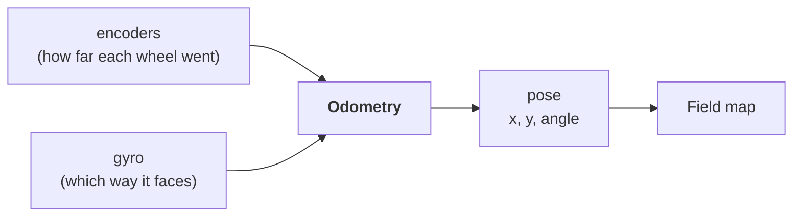
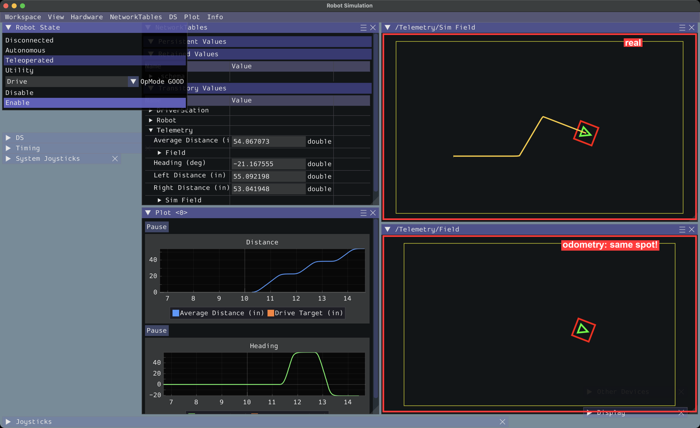
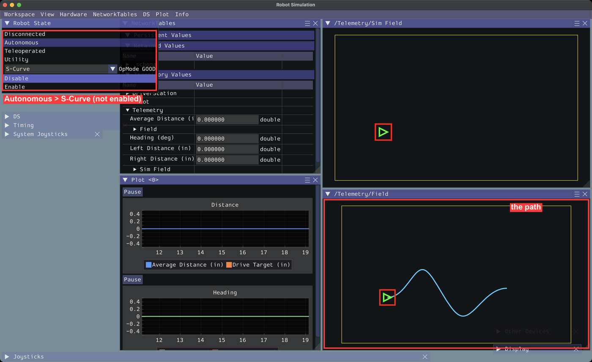
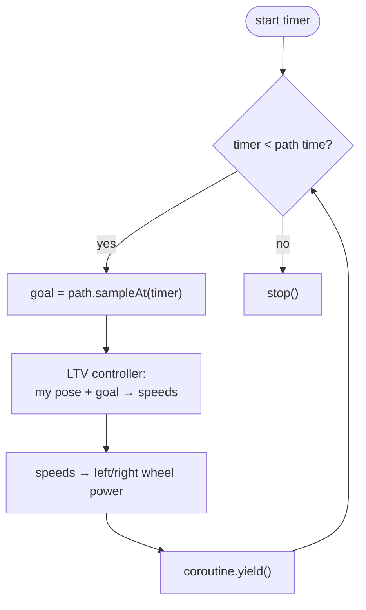
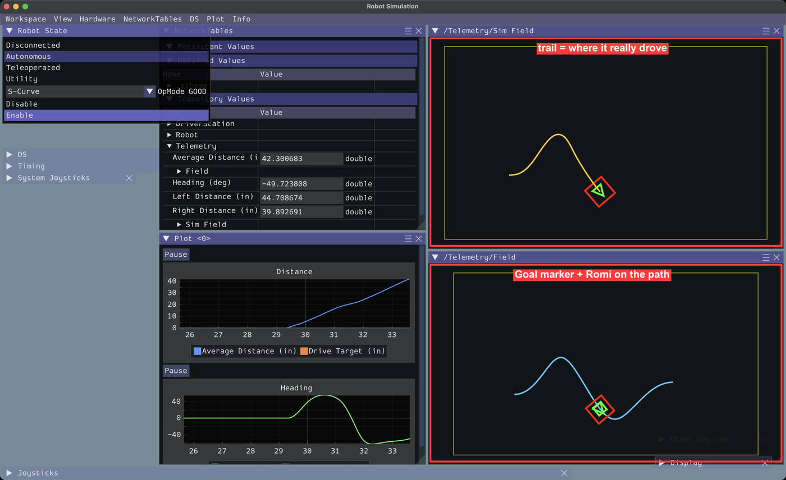
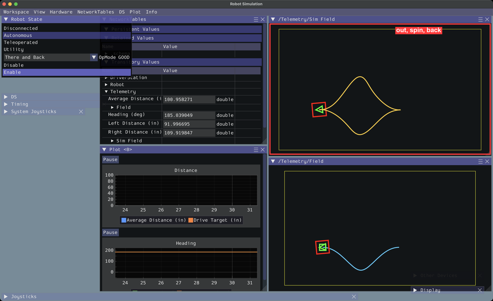

# Task 3: Odometry & Paths

**You'll build:** a map that shows where your Romi *thinks* it is, smooth curvy paths drawn on the map, and an autonomous that follows them.

**Time:** about 1–1.5 hours · **Need:** your finished [Task 2](../Task%202/Instructions.md) project (or copy [`Task 2/Solution`](../Task%202/Solution)).

> Stuck? Each step has a finished copy in [`checkpoints/`](checkpoints).

---

## Step 1: Odometry ("where am I?")

The Romi adds up wheel distances and gyro heading to keep track of its spot on the field.



**Pose** = where the robot is (x, y in meters) + which way it faces.

### 1a. `Constants.java`

Add the imports at the top (under `package frc.robot;`):

```java
import org.wpilib.math.geometry.Pose2d;
import org.wpilib.math.geometry.Rotation2d;
```

Add this inside `DriveConstants` (at the bottom):

```java
    // Odometry
    public static final Pose2d kStartPose = new Pose2d(0.5, 0.5, Rotation2d.ZERO); // meters
```

### 1b. `RomiDrivetrain.java`: imports

```java
import org.wpilib.math.geometry.Pose2d;
import org.wpilib.math.geometry.Rotation2d;
import org.wpilib.math.kinematics.DifferentialDriveOdometry;
import org.wpilib.math.util.Units; // 👈 this Units, not org.wpilib.units.Units
import org.wpilib.smartdashboard.Field2d;
```

### 1c. Variables (below `turnPID`)

```java
  // Odometry keeps track of where the Romi is. The Field2d draws it.
  private final DifferentialDriveOdometry odometry;
  private final Field2d field = new Field2d();
```

### 1d. In the constructor, **after** `resetEncoders();`

```java
    odometry =
        new DifferentialDriveOdometry(
            getRotation(), getLeftDistanceMeters(), getRightDistanceMeters(), kStartPose);
```

### 1e. Methods (put them above `// ---- Commands ----`)

```java
  // ---- Odometry ----

  public Rotation2d getRotation() {
    return Rotation2d.fromDegrees(getHeadingDegrees());
  }

  public double getLeftDistanceMeters() {
    return Units.inchesToMeters(getLeftDistanceInches());
  }

  public double getRightDistanceMeters() {
    return Units.inchesToMeters(getRightDistanceInches());
  }

  /** Where the Romi is on the field (meters). */
  public Pose2d getPose() {
    return odometry.getPose();
  }

  /** Tells odometry "the Romi is here now". */
  public void resetPose(Pose2d pose) {
    odometry.resetPosition(getRotation(), getLeftDistanceMeters(), getRightDistanceMeters(), pose);
  }

  /** Robot.java calls this every 20 ms. */
  public void updateOdometry() {
    odometry.update(getRotation(), getLeftDistanceMeters(), getRightDistanceMeters());
    field.setRobotPose(getPose());
  }
```

Inside `logTelemetry()`:

```java
    Telemetry.log("Field", field); // 👈 add
```

### 1f. `Robot.java`: call it every loop (in `robotPeriodic()`)

```java
    Scheduler.getDefault().run();

    drivetrain.updateOdometry(); // 👈 add
    drivetrain.logTelemetry();
```

> ### ✅ Checkpoint 1
> Look at **both** maps: **Field** (bottom right, where your code *thinks* the Romi is) and **Sim Field** (top right, where it *really* is).
>
> **Teleoperated** → **Drive** → **Enable** → drive around with W/S/E/R. **Both Romis move the same way.** 🎯
>
> 
>
> 🤖 **Real Romi:** **Field** = where your real Romi's sensors say it is. **Sim Field** = the 👻 ghost (where the sim predicts it should be). Mark the start spot with tape, drive around, come back. Is **Field** close to where it started? Is the ghost?

---

## Step 2: Draw a path

You pick a **start**, some **waypoints** to pass through, and an **end**. WPILib makes a smooth curve.

```
 y (meters)
 0.8 ┤          ①
 0.6 ┤                             🏁 end
 0.5 ┤  ▶ start
 0.3 ┤                    ②
     └────┬─────────┬─────────┬─────────┬── x (meters)
         0.5       1.0       1.5       2.0
```
**start** (0.5, 0.5) → through **①** (0.9, 0.8) and **②** (1.3, 0.3) → **end** (1.8, 0.6)

### 2a. `Constants.java` (under `kStartPose`)

```java
    // Paths
    public static final double kTrackWidthMeters = 0.141; // distance between the wheels
    public static final double kMaxPathSpeedMetersPerSec = 0.3;
    public static final double kMaxPathAccelMetersPerSecSq = 0.3;
```

### 2b. `RomiDrivetrain.java`: imports

```java
import java.util.List;
import org.wpilib.math.geometry.Translation2d;
import org.wpilib.math.kinematics.DifferentialDriveKinematics;
import org.wpilib.math.trajectory.DrivetrainSplineTrajectory;
import org.wpilib.math.trajectory.DrivetrainSplineTrajectoryGenerator;
import org.wpilib.math.trajectory.TrajectoryConfig;
```

### 2c. Variable (below the `field` line)

```java
  private final DifferentialDriveKinematics kinematics =
      new DifferentialDriveKinematics(kTrackWidthMeters);
```

### 2d. Methods (above `// ---- Commands ----`)

```java
  // ---- Paths ----

  /** Makes a smooth path from start, through the waypoints, to end. All in meters. */
  public DrivetrainSplineTrajectory makePath(
      Pose2d start, List<Translation2d> waypoints, Pose2d end) {
    var config =
        new TrajectoryConfig(kMaxPathSpeedMetersPerSec, kMaxPathAccelMetersPerSecSq)
            .setKinematics(kinematics);
    return DrivetrainSplineTrajectoryGenerator.generate(start, waypoints, end, config);
  }

  /** Draws a path on the Field. */
  public void showPath(DrivetrainSplineTrajectory path) {
    field.getObject("Path").setTrajectory(path);
  }
```

### 2e. New file **`opmodes/SCurveAuto.java`**

(Like Task 1 Step 2c: **New File** icon, then select all and replace with:)

```java
package frc.robot.opmodes;

import frc.robot.Robot;
import java.util.List;
import org.wpilib.math.geometry.Pose2d;
import org.wpilib.math.geometry.Rotation2d;
import org.wpilib.math.geometry.Translation2d;
import org.wpilib.math.trajectory.DrivetrainSplineTrajectory;
import org.wpilib.opmode.Autonomous;
import org.wpilib.opmode.OpMode;

/** Shows up as "S-Curve" in the Autonomous list of the sim window. */
@Autonomous(name = "S-Curve")
public class SCurveAuto implements OpMode {
  private final Robot robot;
  private final DrivetrainSplineTrajectory path;

  /** Runs when you pick "S-Curve" in the list (even while disabled). */
  public SCurveAuto(Robot robot) {
    this.robot = robot;

    path =
        robot.drivetrain.makePath(
            new Pose2d(0.5, 0.5, Rotation2d.ZERO), // start
            List.of(new Translation2d(0.9, 0.8), new Translation2d(1.3, 0.3)), // go through these
            new Pose2d(1.8, 0.6, Rotation2d.ZERO)); // end

    robot.drivetrain.showPath(path);
  }
}
```

> ### ✅ Checkpoint 2
> Click **Autonomous** → pick **S-Curve** in the OpMode box. **Don't enable yet.**
>
> A wiggly line appears on **Field**. 〰️
>
> Try moving the waypoints, restart, and see the curve change.
>
> 

---

## Step 3: Follow the path

Every 20 ms: look up where the Romi *should* be right now, then steer toward it.



### 3a. `Constants.java` (under the path constants)

```java
    public static final double kMaxSpeedMetersPerSec = 0.6; // Romi top speed at full power
```

### 3b. `RomiDrivetrain.java`: imports

```java
import org.wpilib.math.controller.LTVUnicycleController;
import org.wpilib.math.kinematics.ChassisVelocities;
import org.wpilib.math.kinematics.DifferentialDriveWheelVelocities;
import org.wpilib.math.trajectory.DrivetrainSplineSample;
import org.wpilib.system.Timer;
```

### 3c. Variable (below `kinematics`)

The **LTV controller** is math that steers the Romi back onto the path when it drifts.

```java
  // Steers the Romi back onto the path when it drifts off
  private final LTVUnicycleController pathController = new LTVUnicycleController(0.02);
```

### 3d. A `tankDrive` method (above `stop()`)

```java
  /** Drives each side separately. -1 to 1. */
  public void tankDrive(double leftSpeed, double rightSpeed) {
    diffDrive.tankDrive(leftSpeed, rightSpeed, false);
  }
```

### 3e. The command (below `turnLeftPID`)

```java
  /** Follows a path from start to end. */
  public Command followPath(DrivetrainSplineTrajectory path) {
    return run(coroutine -> {
          showPath(path);
          Timer timer = Timer.createStarted();

          while (timer.get() < path.duration) {
            // Where should the Romi be right now?
            DrivetrainSplineSample goal = path.sampleAt(timer.get());
            field.getObject("Goal").setPose(goal.pose);

            // How fast should it go to get there? (meters per second)
            ChassisVelocities speeds = pathController.calculate(getPose(), goal);
            DifferentialDriveWheelVelocities wheels = kinematics.toWheelVelocities(speeds);

            // Turn wheel speeds into motor power (-1 to 1)
            tankDrive(wheels.left / kMaxSpeedMetersPerSec, wheels.right / kMaxSpeedMetersPerSec);
            coroutine.yield();
          }

          stop();
        })
        .named("Follow Path");
  }
```

### 3f. `SCurveAuto.java`: start it when enabled

Add the import:

```java
import org.wpilib.command3.Scheduler;
```

Add this method below the constructor:

```java
  /** Runs once when the robot is enabled. */
  @Override
  public void start() {
    robot.drivetrain.resetPose(path.start().pose); // "the Romi is at the start of the path"
    Scheduler.getDefault().schedule(robot.drivetrain.followPath(path));
  }
```

> ### ✅ Checkpoint 3
> **Restart the sim** (so the Romi is at the start) → Autonomous → **S-Curve** → **Enable**.
>
> The **Goal** marker slides along the line, and the Romi chases it on **both** maps. It stops at the end of the line. 🏁
>
> 
>
> 🤖 **Real Romi:** if it falls behind the Goal marker, lower `kMaxSpeedMetersPerSec` a little. If it zooms ahead, raise it.

---

## Step 4: There and back

Combine everything: follow a path, PID-turn around, follow a path back.

New file **`opmodes/ThereAndBackAuto.java`** (New File icon, select all, replace):

```java
package frc.robot.opmodes;

import frc.robot.Robot;
import java.util.List;
import org.wpilib.command3.Command;
import org.wpilib.command3.Scheduler;
import org.wpilib.math.geometry.Pose2d;
import org.wpilib.math.geometry.Rotation2d;
import org.wpilib.math.geometry.Translation2d;
import org.wpilib.math.trajectory.DrivetrainSplineTrajectory;
import org.wpilib.opmode.Autonomous;
import org.wpilib.opmode.OpMode;

/** Shows up as "There and Back": drive a curve out, spin around, drive a curve back. */
@Autonomous(name = "There and Back")
public class ThereAndBackAuto implements OpMode {
  private final Robot robot;
  private final DrivetrainSplineTrajectory there;
  private final DrivetrainSplineTrajectory back;

  public ThereAndBackAuto(Robot robot) {
    this.robot = robot;
    var drivetrain = robot.drivetrain;

    there =
        drivetrain.makePath(
            new Pose2d(0.5, 0.5, Rotation2d.ZERO),
            List.of(new Translation2d(1.0, 0.9)),
            new Pose2d(1.5, 0.5, Rotation2d.ZERO));

    // Starts facing backwards (180 degrees) where "there" ended
    back =
        drivetrain.makePath(
            new Pose2d(1.5, 0.5, Rotation2d.fromDegrees(180)),
            List.of(new Translation2d(1.0, 0.2)),
            new Pose2d(0.5, 0.5, Rotation2d.fromDegrees(180)));

    drivetrain.showPath(there);
  }

  @Override
  public void start() {
    var drivetrain = robot.drivetrain;
    drivetrain.resetPose(there.start().pose);

    Command auto =
        Command.noRequirements(coroutine -> {
              coroutine.await(drivetrain.followPath(there));
              coroutine.await(drivetrain.turnLeftPID(180));
              coroutine.await(drivetrain.followPath(back));
            })
            .named("There and Back");

    Scheduler.getDefault().schedule(auto);
  }
}
```

> ### ✅ Checkpoint 4
> Restart → Autonomous → **There and Back** → Enable.
>
> The Romi curves up and out, spins 180°, curves back under, and stops where it started. The **trail** on **Sim Field** draws a loop. 🔁
>
> 

---

## 🎉 Done!

| You learned | Code |
|---|---|
| Odometry | `DifferentialDriveOdometry`, `getPose()` |
| Drawing on a map | `Field2d`, `getObject("Path").setTrajectory(...)` |
| Making paths | `DrivetrainSplineTrajectoryGenerator.generate(...)` |
| Following paths | `LTVUnicycleController` + `kinematics.toWheelVelocities(...)` |
| Big autos from small commands | `coroutine.await(...)` one after another |

### Challenges (optional)
Answers (tested in the sim) are in [`challenges/`](challenges) — try first!

- Make a **Figure 8** auto: 2 paths that each loop around and meet in the middle. (Hint: copy `ThereAndBackAuto`. A loop needs ~3 waypoints, and the second path starts exactly where the first ends, same angle.)
- Make a **Curve then Square** auto: `followPath` the S-curve, then the Square PID loop.
- Speed it up: raise `kMaxPathSpeedMetersPerSec` (try 0.45, 0.6, 0.8, 1.0) and watch the Goal marker. When does the Romi stop keeping up, and why? (Hint: compare with `kMaxSpeedMetersPerSec`. Why doesn't the path get much faster?)

<details>
<summary>❌ Something's wrong?</summary>

| Problem | Fix |
|---|---|
| **Field** and **Sim Field** don't match | Restart the sim. `resetPose` tells odometry it's at the path start, so the Romi on **Sim Field** must be there too. |
| No line on **Field** | Pick the auto in the list first. The path is made when you pick it. |
| Romi spins in circles | Check the `-` in `getHeadingDegrees()` (turning left must make Heading go up), or `kTrackWidthMeters` is wrong. |
| Crash: "points too close" | Waypoints must be spaced apart and not double back on themselves. |

</details>
