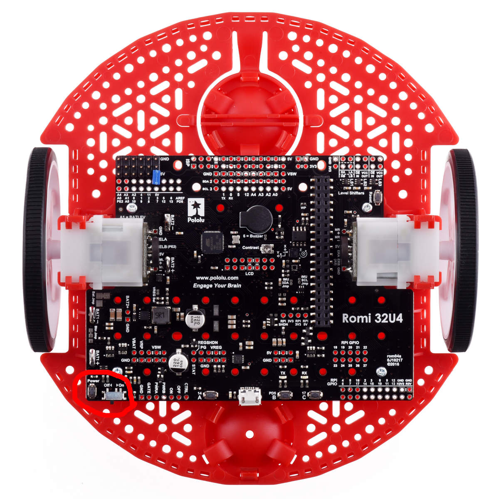
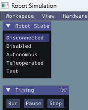
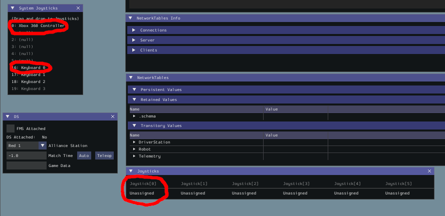

# Task 0: Configuring Computer

## Overview

It is recommended to bring your own laptop as school laptops have limitations. We have 2 drive laptops that can sometimes be used for coding, but they are often being used to test the robot.

## Downloading WPILib

Go to [https://github.com/wpilibsuite/allwpilib/releases/latest/](https://github.com/wpilibsuite/allwpilib/releases/latest/), scroll down to the download section and find your OS and download the installer.


Then Follow these instructions [https://docs.wpilib.org/en/stable/docs/zero-to-robot/step-2/wpilib-setup.html#extracting-the-installer](https://github.com/wpilibsuite/allwpilib/releases/latest/) to extract the installer and then run it.
During the install select the option to install everything, install for all users(if its an option) and to download VSCode with `Download for this computer only`

## Downloading Git

### Windows

If you use a package manager like [winget](https://learn.microsoft.com/en-us/windows/package-manager/) or [chocolatey](https://chocolatey.org/), use those to install git, otherwise go to [https://git-scm.com/install/windows](https://git-scm.com/install/windows) then download and run the standalone installer.

### MacOS

If you use homebrew then run `brew install git` in a terminal, otherwise run `xcode-select --install` in a terminal.

### Linux

Its probably already installed, you can check by running `which git` if not run `<your favorate package manager invocation to install packages> git`.

## Configuring Git

In order to use git you need to configure a few options, all of these can be configured by running `git config --global <the setting>` in a terminal.

- `user.name=<your name>` Your name should be something identifiable, but beware it will be public
- `user.email=<your forgejo username>@noreply.localhost`

There a few more settings you should set to make git easier to use

- `rerere.enabled=true`
- `push.autosetupremote=true`
- `pull.rebase=true`
- `pull.merge=false`
- `rebase.autostash=true`


## Creating your first robot project

Find the WPILib logo  in the top right of vscode, clicking on it will then open the command pallet in the top center with `>WPILib:` already filled out (you can also just type this in by hand), then search for `Create a new project`, you can then either hit enter or click on the command to begin project setup. You want to create a Template in java with romi command robot as the base, then select where you want to put the project and what you want to name it, finally set the team number to `8248` and create the project.

## Running code

### Connecting to the Romis



First power on the romi by flipping the power switch to the on position. Once you are done with the romi flip the switch to the off position and then press the button next to the switch. If you here the romi beeping that means it is low on battery.

Once the romi is on you can connect to the romis, by disconnecting from your current wi-fi network and find the romi's network(either romi-1 or romi-2 the number is on the bottom), the password will be set to `82488248`. 

If you can't find it, here are some common causes:

- Romi is off
- Romi is out of battery
- You are attempting to connect to the wrong romi
- You have wi-fi disabled
- Someone's already connected to the romi

### Starting the program

Click on the same WPILib logo you used to create the project but instead search for `Simulate Robot Code` once the program build and starts you will see the Sim Gui

### Sim Gui


#### Robot State




This is the current state of the robot. The robot can be:

- Disconnected: The robot is not receiving any instructions from the computer.
- Disabled: It is communicating with the computer, but is unable to move.
- Autonomus: It will run code and move around without any human inputs.
- Teleoperate: The human will be able to give the robot inputs for it to drive around an proform actions.

#### Joysticks



On the left you can see all of the controllers/joysticks that the SimGui detects, with the controllers at the top and the keyboard at the bottom.
You can then drag whichever controller/joystick you want to you onto port 0.

#### Other

You will almost never need to touch the other sim elements, such as Timing and Network tables. If it is necessary, an experienced member will tell you.

## Conventions

### Naming Conventions

On ChainLynx, we use the following naming conventions

```java
// For classes
public class RobotContainer {}

// For objects,
private Subsystem elevatorSubsystem;

// For constants,

public static final double kMaxVelocity;

// For class fields,

private double speedMultiplier;
```

### Units

[The Units library](https://docs.wpilib.org/en/stable/docs/software/basic-programming/java-units.html) allows you to store physical measurements such as distance or angle rather than just storing a number. This can help eliminate mistakes, if for example you were given a number and you thought it was in pounds but it was in kilograms. Anytime a value that can be represented as a unit is used it should be.
