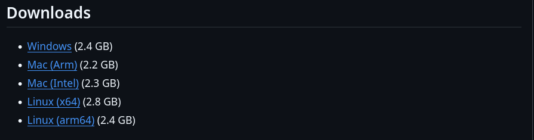

# Task 0: Configuring Computer

## Overview

It is recommended to bring your own laptop as school laptops have limitations. We have 2 drive laptops that can sometimes be used for coding, but they are often being used to test the robot.

## Downloading WPILib

Go to [https://github.com/wpilibsuite/allwpilib/releases/latest/](https://github.com/wpilibsuite/allwpilib/releases/latest/), scroll down to the download section and find your OS and download the installer.



Then Follow these instructions [https://docs.wpilib.org/en/stable/docs/zero-to-robot/step-2/wpilib-setup.html#extracting-the-installer](https://github.com/wpilibsuite/allwpilib/releases/latest/) to extract the installer and then run it.
During the install select the option to install everything, install for all users(if its an option) and to download VSCode with `Download for this computer only`

## Downloading Git

### Windows

If you use a package manager like [winget](https://learn.microsoft.com/en-us/windows/package-manager/) or [chocolatey](https://chocolatey.org/), use those to install git, otherwise go to [https://git-scm.com/install/windows](https://git-scm.com/install/windows) then download and run the standalone installer.

### MacOS

If you use homebrew then run `brew install git` in a terminal, otherwise run `xcode-select --install` in a terminal.

### Linux

Its probably already installed, you can check by running `which git` if not run `<your favorate package manager invocation to install packages> git`.

## Configuring Git

In order to use git you need to configure a few options, all of these can be configured by running `git config --global <the setting>` in a terminal.

- `user.name=<your name>` Your name should be something identifiable, but beware it will be public
- `user.email=<your forgejo username>@noreply.localhost`

There a few more settings you should set to make git easier to use

- `rerere.enabled=true`
- `push.autosetupremote=true`
- `pull.rebase=true`
- `pull.merge=false`
- `rebase.autostash=true`

## Conventions

### Naming Conventions

On ChainLynx, we use the following naming conventions

```java
// For classes
public class RobotContainer {}

// For objects,
private Subsystem elevatorSubsystem;

// For constants,

public static final double kMaxVelocity;

// For class fields,

private double speedMultiplier;
```

### Units

[The Units library](https://docs.wpilib.org/en/stable/docs/software/basic-programming/java-units.html) allows you to store physical measurements such as distance or angle rather than just storing a number. This can help eliminate mistakes, if for example you were given a number and you thought it was in pounds but it was in kilograms. Anytime a value that can be represented as a unit is used it should be.
