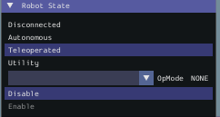

# Task 1

In task 1 you will learn how to run code on a romi, the structure of a robot project, and write code to drive around with a joystick, and drive a certain distance.

## Setting up the project

Clone the [Romi-Projects repo](https://git.emeraldcityrobotics.org/chainlynx/Romi-Projects) and then copy the `Template` folder from `Task 1` into wherever you store you code. Then open the project in WPILib vscode.

## Running code

### Connecting to the Romis


First power on the romi by flipping the power switch to the on position. Once you are done with the romi flip the switch to the off position and then press the button next to the switch. If you here the romi beeping that means it is low on battery.

Once the romi is on you can connect to the romis, by disconnecting from your current wi-fi network and find the romi's network(either romi-1 or romi-2 the number is on the bottom), the password will be set to `82488248`.

If you can't find it, here are some common causes:

- Romi is off
- Romi is out of battery
- You are attempting to connect to the wrong romi
- You have wi-fi disabled
- Someone's already connected to the romi

### Starting the program

Click on the  and then search for `Simulate Robot Code` once the program builds and starts you will see the Sim Gui

### Sim Gui


#### Robot State



This is the current state of the robot. The robot can be:

- Disconnected: The robot is not receiving any instructions from the computer.
- Autonomus: It will run code and move around without any human inputs.
- Teleoperated: The human will be able to give the robot inputs for it to drive around an proform actions.
- Utility: Same as Teleoperated but for utility tasks such as tuning rather than playing the game

In all of the modes except for disconnected you can be either enabled or disabled. In disabled the robot wont be able to move but will still run parts of the code for that mode. When enabled all of the motors on the robot are now allowed to move.

#### Joysticks


On the left you can see all of the controllers/joysticks that the SimGui detects, with the controllers at the top and the keyboard at the bottom.
You can then drag whichever controller/joystick you want to you onto port 0.

#### Other

You will almost never need to touch the other sim elements, such as Timing and Network tables.

## Parts of a robot program

All of the code for the project is stored in the `src/main/java/first/robot` folder.

### `Robot.java`

The robot class holds all of the subsystems as well as holding all of the logic thats not specific to one subsystem or OpMode (We will talk about these next).

### OpModes

Stored in the `opmodes` folder. Each OpMode controls the operation of the robot in a specific mode. When running code for mode there is a dropdown menu to select which OpMode you want to use.

Further explanation [FRCSoftware](https://frcsoftware.org/learning-course/stage1/stage1a/kitbot-drivetrain/#opmodes), [WPILib docs](https://docs.wpilib.org/en/latest/docs/software/basic-programming/opmodes.html).

### Subsystems

Stored in the `subsystems` folder. A subsystem is a portion of the robot that can operate mostly independently, eg. shooter, indexer, intake, vision, etc. They store the parts like motors and the logic that controls them. The only subsystem on a romi is the drivetrain.

## Driving around with a controller

The first step is to give `ExampleOpMode` a better name like `ControllerDriving`. You can just rename the File and vscode will ask if you want to automatically change everything else, click yes.

In `ControllerDriving.java` you will find (extra comments added to explain sections of the code)

```java
@Teleop // This tells WPILib that this OpMode is for Teleop
public class ControllerDriving extends PeriodicOpMode {
  private final Robot robot;

  public ControllerDriving(Robot robot) {
    this.robot = robot;
  }

  @Override
  public void start() {
    // Code to run when the robot transitions from disabled to enabled

  @Override
  public void periodic() {
    // Runs every 20ms when enabled
  }

  // there are also other methods that we can override from PeriodicOpMode
  // such as disabledPeriodic but we wont need them in the romi tasks.
}
```

In order to drive around with a controller we will need to do 2 things, get the x and y axis values of a joystick, and then use those values to tell the robot how fast to go forward and how much to turn.

The first step in this plan is to create a controller assuming your using an Xbox controller (All of the teams controller are), then you will want to create a `XboxController` bound to port 0 (`XboxController` has multiple constructors make sure to use the one that takes the port id as an integer) and store it in a private final member variable of the class named `driveController` (or another descriptive name), private because no one outside of the OpMode needs to access it, final because it never needs to be changed, and a member variable so that it will stick around the entire life of the OpMode. (In the future if a variable is private or final will not always be specified so think about who will need to access the variable and if it ever needs to be changed)

`private final XboxController driveController = new XboxController(0);`

One importiant note is that joysticks dont use the same coordinate system that the robot does, for a joystick -y is forward +y is backwards -x is left and +x is right, for more info see [WPILib docs](https://docs.wpilib.org/en/latest/docs/software/basic-programming/coordinate-system.html#joystick-and-controller-coordinate-system)

In order to command the romi we will use a method called `arcadeDrive` it takes in two values `xaxisSpeed`, how fast to drive forward and `zaxisRotate`, how much to turn, both in a -1 - 1 range.

In order to make sure that it will update the inputs while driving we will want to call `arcadeDrive` in `periodic`. In order to get the joystick angles of the controller you can call a getter method on `driveController`, try to figure out what its called, but if you get stuck you can look at the solution.
<details>
    <summary>Solution</summary>

`driveController.getLeftX()` and `getLeftY()` or `getRightX` and `getRightY` if you are using the right joystick on the controller.

</details>

We can now plug the joystick values into the arcade drive function making sure to correct for the different coordinate systems.

```java
  @Override
  public void periodic() {
    // Runs every 20ms when enabled
    robot.drivetrain.arcadeDrive(-driveController.getLeftY(), -driveController.getLeftX());
  }
```

If we now run out code the romi should drive with these controls


