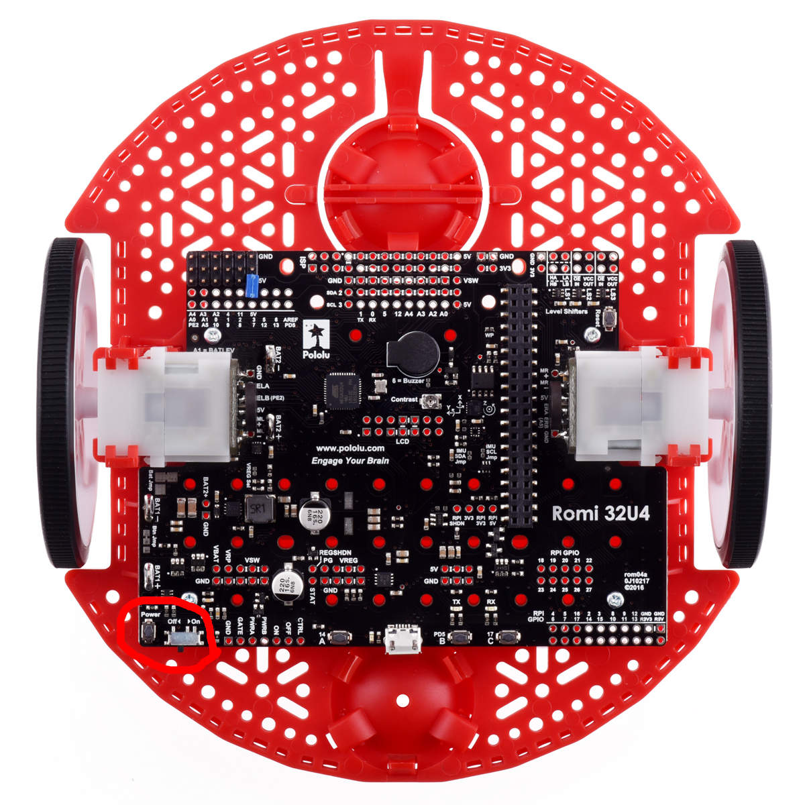
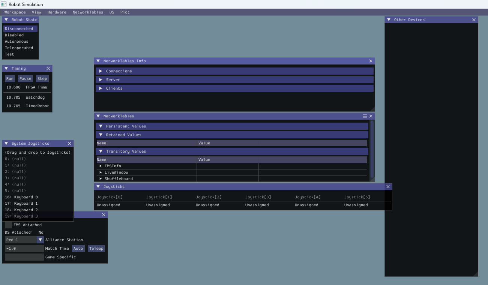
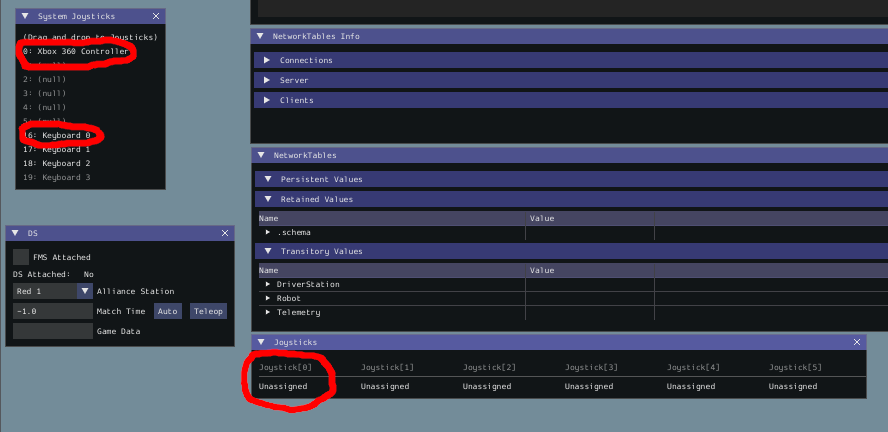

# Task 1

In task 1 you will learn how to run code on a romi, the structure of a robot project, and write code to drive around with a joystick, and drive a certain distance.

## Setting up the project

Clone the [Romi-Projects repo](https://git.emeraldcityrobotics.org/chainlynx/Romi-Projects) and then copy the `Template` folder from `Task 1` into wherever you store you code. Then open the project in WPILib vscode.

## Running code

### Connecting to the Romis

First power on the romi by flipping the power switch to the on position. Once you are done with the romi flip the switch to the off position and then press the button next to the switch. If you here the romi beeping that means it is low on battery.

Once the romi is on you can connect to the romis, by disconnecting from your current wi-fi network and find the romi's network(either romi-1 or romi-2 the number is on the bottom), the password will be set to `82488248`.

If you can't find it, here are some common causes:

- Romi is off
- Romi is out of battery
- You are attempting to connect to the wrong romi
- You have wi-fi disabled
- Someone's already connected to the romi

### Starting the program

Click on the  and then search for `Simulate Robot Code` once the program builds and starts you will see the Sim Gui

### Sim Gui

#### Robot State

This is the current state of the robot. The robot can be:

- Disconnected: The robot is not receiving any instructions from the computer.
- Autonomus: It will run code and move around without any human inputs.
- Teleoperated: The human will be able to give the robot inputs for it to drive around an proform actions.
- Utility: Same as Teleoperated but for utility tasks such as tuning rather than playing the game

In all of the modes except for disconnected you can be either enabled or disabled. In disabled the robot wont be able to move but will still run parts of the code for that mode. When enabled all of the motors on the robot are now allowed to move.

#### Joysticks

On the left you can see all of the controllers/joysticks that the SimGui detects, with the controllers at the top and the keyboard at the bottom.
You can then drag whichever controller/joystick you want to you onto port 0.

#### Other

You will almost never need to touch the other sim elements, such as Timing and Network tables.

