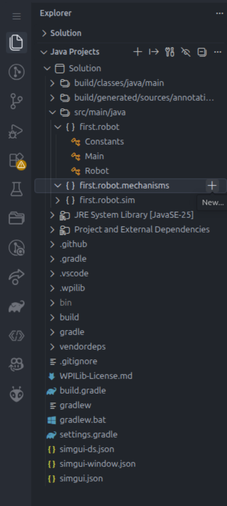
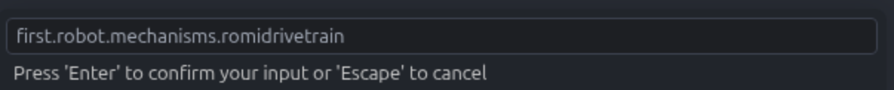
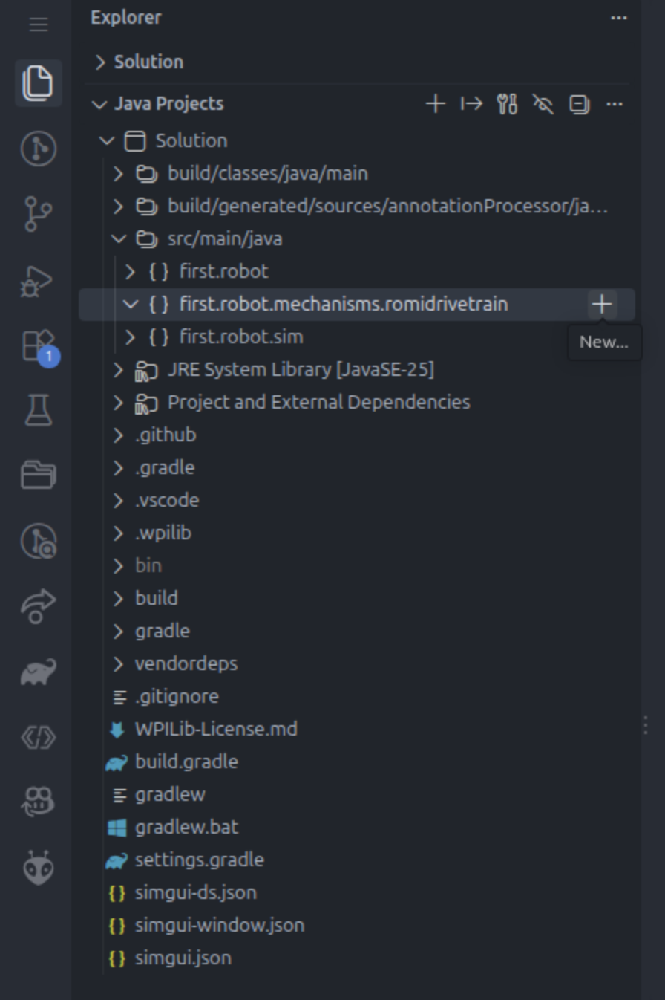
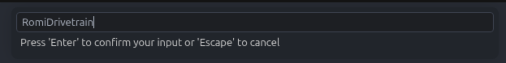
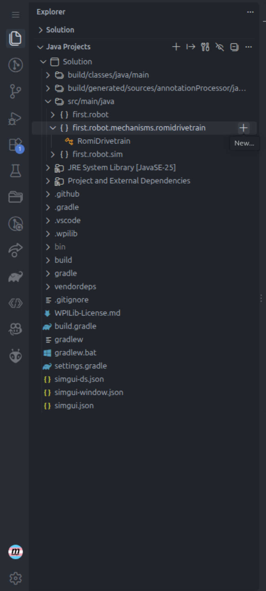
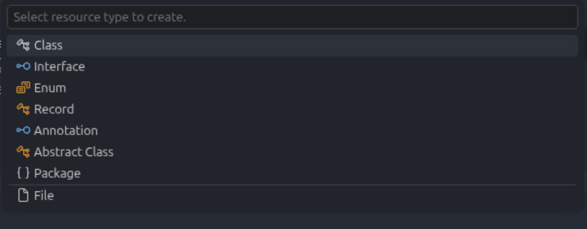
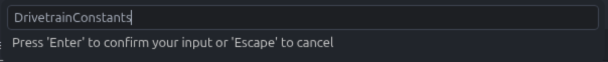
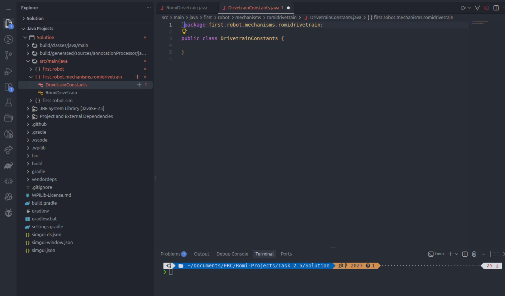

# Task 2.5: Creating a Subsystem

You'll build: The RomiDrivetrain template you used in Task 1.

**Time:** about 1 hour · **Need:** Nothing, but finishing Task 1 and Task 2 will help you build intuition.

> [!TIP]
> Stuck? Each step has a finished copy in [`checkpoints/`](checkpoints).

---

## Step 1: Create the Subsystem Files

To start the process of creating a subsystem, first create a file for it. You should use the `Java Projects` view over the normal Explorer view since it groups by package and allows you to create Java files directly.

Create a new package to store the subsystem in called `romidrivetrain`. Package names typically are all lowercase and don't have spaces. We can do this by the plus on the `first.robot.mechanisms` package.

 

Then select `Package`:

 

Then name the package:

 

 You should see the package under mechanisms change to the new package you just created (since there are no other subpackages in the mechanisms package right now). Now we need to create a class for the subsystem.

 

 Select class.

 

It will prompt you to name your new class. Call it `RomiDrivetrain`. 

 

Pressing enter should take you to a new blank class like below.

 

Next, we must implement `Mechanism`. All robot mechanisms (aka subsystems) must implement this interface. To implement simply add `implements Mechanism` after `RomiDrivetrain` like so:

```java
public class RomiDrivetrain implements Mechanism {

}
```

>[!TIP]
>`Mechanism` is located in the package `org.wpilib.command3`. We have to add the import to use it, but VSCode will suggest it as we type. Press [enter] to take the suggestion and VSCode will automatically add the needed import.

## Step 2: Declaring Hardware Components

Every subsystem you will ever create is made up of hardware components. We can broadly classify hardware components as:
- Actuators - Hardware components that allow physical interaction with the world
  
| Type             | Motion produced                  | How it works                                                                                                                                                                                           |
| ---------------- | -------------------------------- | ------------------------------------------------------------------------------------------------------------------------------------------------------------------------------------------------------ |
| Motor            | Circular rotation                | An electrical voltage applied across the motors terminals generate internal magnetic fields that cause a central shaft to start spinning until it reaches a speed proportional to the voltage applied. |
| Servo            | Rotation to a position           | A more specialized motor that can precisely turn to specific positions that have been electrically marked. Cannot continuously turn like a normal motor.                                               |
| Pneumatic Piston | Linear motion between two points | Compressed air is used to either extend or retract a piston                                                                                                                                            |
 
- Sensors - Hardware components that give information about the physical world


| Type                 | What is senses         | How it works                                                                                                                                                                   |
| -------------------- | ---------------------- | ------------------------------------------------------------------------------------------------------------------------------------------------------------------------------ |
| Encoder              | Rotational position    | Marked "ticks" along it count the amount of rotation like marks on a clock as the hands turn. Typically used to measure how much a motor turns.                                |
| String potentiometer | Linear position        | A tether that, when pulled, turns a dial whose resistance changes as it is turned.                                                                                             |
| Gyro(scope)          | Orientation            | Tiny vibrating masses inside the device along with microscopic force sensors detect angular motion and relative to a starting position.                                        |
| Camera               | Position + Orientation | Uses the known geometry of objects with the way they appear in a frame of a video to estimate the position and orientation of an object relative to the position of the camera |
| Limit switch         | Binary position        | A small lever switch that emits a signal when it is held down. Used to detect when a mechanism is at some mechanical limit we don't want it to surpass.                        |
| Line break sensor    | Binary position        | Uses a beam of light to detect if an object has passed in front of it. Often used to tell if an actuator has "grabbed" some object.                                            |

Now let's think about what actuators and sensors are available to the drivetrain:
- Actuators:
  - 2 DC motors, one for each side (`RomiMotor`)
- Sensors:
  - 2 encoders, one for each motor (`Encoder`)
  - 1 gyro(scope) (`RomiGyro`)

Now we list these components in the subsystem's class. Components should be marked `protected final`. Make sure you give your components descriptive names and not just `component`. Someone should be able to look at the variable's name and figure out which physical part of the robot that it corresponds to (e.g. `frontLeftMotor`).

The types for the hardware components are:

```java
public class ExampleMechanism implements Mechanism {
    protected final ExampleComponentType component;
}
```

>[!TIP]
> You can declare multiple variables of the same type at once like so:
> ```java 
> public class ExampleMechanism implements Mechanism {
>    protected final ExampleComponentType component1, component2;
>}
>```

>[!NOTE]
> Java types are typically in PascalCase while variables are in camelCase. In PascalCase the first letter of every word is capitalized. camelCase is similar, except the first word is always entirely lowercase. Try to follow these guidelines to keep your code readable.

<details>
<summary> Solution </summary> 

```java
public class RomiDrivetrain implements Mechanism {
    protected final RomiMotor leftMotor, rightMotor;
    protected final Encoder leftEncoder, rightEncoder;
    protected final RomiGyro gyro;
}
```
</details>

## Step 3: Creating the constructor

A class's *constructor* defines how to create objects of its type. It is a special function that shares the name of the class and should be marked `public`.  Every mechanism's constructor must take in the components we just defined and initialize them. Sensors will need to be reset. For example:

```java
public class ExampleMechanism implements Mechanism {
    protected final ExampleComponentType component1, component2;

    public ExampleMechanism(ExampleComponentType component1, ExampleComponentType component2) {
        this.component1 = component1;
        this.component2 = component2;

        this.component1.reset();
    }
}
```

>[!NOTE]
> The Java keyword `this` solves naming conflicts. Inside the `ExampleMechanism` constructor,
> there are two variables named `component1`. One is an input to the constructor function, and one
> is a property of the class we wish to initialize. `this` allows us to refer to the one in the class unambiguously.

>[!WARNING]
>The comma syntax for declaring multiple variables of the same type doesn't work for inputs to a function. Notice how I still had to write `ExampleComponent` twice in the constructor's input list.

<details>
<summary> Solution </summary> 

```java
public class RomiDrivetrain implements Mechanism {
    protected final RomiMotor leftMotor, rightMotor;
    protected final Encoder leftEncoder, rightEncoder;
    protected final RomiGyro gyro;

    public RomiDrivetrain(RomiMotor leftMotor, RomiMotor rightMotor, Encoder leftEncoder, Encoder rightEncoder, RomiGyro gyro) {
        this.leftMotor = leftMotor;
        this.rightMotor = rightMotor;

        this.leftEncoder = leftEncoder;
        this.rightEncoder = rightEncoder;

        this.leftEncoder.reset();
        this.rightEncoder.reset();
        
        this.gyro = gyro;
        this.gyro.reset();
    }
}
```
</details>


## Step 4: Mapping Constants


Every subsystem usually has a list of associated constants, usually containing at least, the ports where actuators and sensors are plugged into the robot controller. We'll need to create a file that stores these. 

Open up the Java Projects view once again and click on the plus next to the `first.robot.mechanisms.romidrivetrain` package.

 

Then, create a new class called `DrivetrainConstants`. 

 

 

 This should create a blank `DrivetrainConstants` file under the `first.robot.mechanisms.romidrivetrain` package.

 

 ### Step 4a: Port Mappings and Settings

Each component we declared in `RomiDrivetrain` has an associated set of constants that we must now declare. We put them in the `DrivetrainConstants` file for organizational purposes so we don't need to dig around to change port assignments.

Find out the necessary constants by checking the documentation for each class's constructor (linked below):
- [`RomiMotor`](https://github.wpilib.org/allwpilib/docs/beta/java/wpilib.romi/org/wpilib/romi/RomiMotor.html)
- [`Encoder`](https://github.wpilib.org/allwpilib/docs/beta/java/wpilib.core/org/wpilib/hardware/rotation/Encoder.html)
- [`RomiGyro`](https://github.wpilib.org/allwpilib/docs/beta/java/wpilib.romi/org/wpilib/romi/RomiGyro.html)

Make sure to mark constants as `public static final`. The relavent port mappings are listed in the following table:

| Component     | Port Mappings                     |
| ------------- | --------------------------------- |
| Left Motor    | `channel = 0`, `inverted = false` |
| Right Motor   | `channel = 1`, `inverted = true`  |
| Left Encoder  | `channelA = 4`, `channelB = 5`    |
| Right Encoder | `channelB = 6`, `channelB = 7`    |

>[!NOTE]
>Constants are typically formatted in SCREAMING_SNAKE_CASE.

>[!NOTE]
>`public static` allows the constant to be accessed from other files. `final` marks the variable as constant (never changed).

<details>
<summary> Solution </summary> 

```java
public class DrivetrainConstants {
    public static final int
        LEFT_MOTOR_ID = 0,

        RIGHT_MOTOR_ID = 1,

        LEFT_ENCODER_CHANNEL_A = 4
        LEFT_ENCODER_CHANNEL_B = 5,
        
        RIGHT_ENCODER_CHANNEL_A = 6,
        RIGHT_ENCODER_CHANNEL_B = 7;
    
    public static boolean
        LEFT_MOTOR_INVERTED = false,
        RIGHT_MOTOR_INVERTED = true;
}
```
</details>

### Step 4b: Geometry Constants

Next, we need to put some constants that encoder the real world geometry of the robot. The encoders tell us how much motors turn. To turn that into a number that measures distance, we need the dimensions of the wheel. How far we've traveled is just `number of rotations * wheel circumference`.

WPILib has a way of encoding units to our constants so we don't get our units mixed up. You should get used to using metric as it makes a lot of math easier. Unitless constants should stay as `double`.

| Relavent Geometry                       | Value           |
| --------------------------------------- | --------------- |
| Number of encoder counts per revolution | 1440 (unitless) |
| Wheel Radius                            | 35 mm           |

To declare a constant with units:

```java
import static org.wpilib.units.Units.*;

public class ExampleConstants {
    public static final double unitlessConstant = 1.0;
    public static final Distance somethingInMeters = Meters.of(2);
    public static final Distance somethingElseInMeters = somethingInMeters.plus(1);
        public static final Distance somethingElseElseInMeters = somethingInMeters.times(3);
}
```

Declare the two constants given and also a constant that represents the circumference of the wheel using the formula $ C = 2\pi r$.

```java
import static org.wpilib.units.Units.*;

public class DrivetrainConstants {
    public static final int
        LEFT_MOTOR_ID = 0,

        RIGHT_MOTOR_ID = 1,

        LEFT_ENCODER_CHANNEL_A = 4
        LEFT_ENCODER_CHANNEL_B = 5,
        
        RIGHT_ENCODER_CHANNEL_A = 6,
        RIGHT_ENCODER_CHANNEL_B = 7;
    
    public static boolean
        LEFT_MOTOR_INVERTED = false,
        RIGHT_MOTOR_INVERTED = true;

    public static final double COUNTS_PER_REVOLUTION = 1440;
    public static final Distance WHEEL_RADIUS = Millimeters.of(35);
    public static final Distance WHEEL_CIRCUMFERENCE = WHEEL_RADIUS.times(2 * Math.PI);
}
```

>[!NOTE]
>No matter what, one of the sides of the motors will need to be reversed since they are flipped so counterclockwise on one side will turn backwards while on the other side will turn forwards.

Make sure to go back to the constructor and set the inversion for each motor based on the constants.

<details>
<summary> Solution </summary> 

```java
public class RomiDrivetrain implements Mechanism {
    protected final RomiMotor leftMotor, rightMotor;
    protected final Encoder leftEncoder, rightEncoder;
    protected final RomiGyro gyro;

    public RomiDrivetrain(RomiMotor leftMotor, RomiMotor rightMotor, Encoder leftEncoder, Encoder rightEncoder, RomiGyro gyro) {
        this.leftMotor = leftMotor;
        this.rightMotor = rightMotor;

        this.leftMotor.setInverted(DriveConstants.LEFT_MOTOR_INVERTED);
        this.rightMotor.setInverted(DriveConstants.RIGHT_MOTOR_INVERTED);

        this.leftEncoder = leftEncoder;
        this.rightEncoder = rightEncoder;

        this.leftEncoder.reset();
        this.rightEncoder.reset();
        
        this.gyro = gyro;
        this.gyro.reset();
    }
}
```
</details>

## Step 5: Instantiating the Subsystem

The `RomiDrivetrain` class defines a template for the subsystem. To actually create the subsystem, we need to use the template to create a `RomiDrivetrain` object. This is done in `Robot` in a block with the other subsystems. We've put a comment where you should put your instantiation.

To instantiate the subsytem, we simply give it the components we defined it needed in its constructor. For the example subsystem, we invoke its constructor as follows:

```java
import first.robot.mechanisms.romidrivetrain.ExampleConstants;

public class Robot extends OpModeRobot {
  // ---- Mechanisms ----
  public final var exampleSubsystem = 
    new ExampleSubsystem(new ExampleComponent(ExampleConstants.EXAMPLE_CHANNEL));
}
```

Note that the components on the `RomiDrivetrain` will need to be passed the appropriate channels we've defined in `DrivetrainConstants`.

```java
import first.robot.mechanisms.romidrivetrain.ExampleConstants;

public class Robot extends OpModeRobot {
  // ---- Mechanisms ----
  public final var drivetrain = new RomiDrivetrain(
    new RomiMotor(DrivetrainConstants.LEFT_MOTOR_ID),
    new RomiMotor(DrivetrainConstants.RIGHT_MOTOR_ID),
    new Encoder(DrivetrainConstants.LEFT_CHANNEL_A, DrivetrainConstants.LEFT_CHANNEL_B),
    new Encoder(DrivetrainConstants.RIGHT_CHANNEL_A, DrivetrainConstants.RIGHT_CHANNEL_B),
    new RomiGyro()
  );
}
```

## Step 6: Define Basic Actuator Functionality

The subsystem is now defined, but currently it doesn't really define any actions that it can do. The next step is to think about basic actions of your subsystem. The drivetrain's most basic action is driving, so we will need functions that allow the drivetrain to do so.


### Step 6a: Create a `DifferentialDrive` object

Luckily for us, WPILib's `DifferentialDrive` object does the hard math of converting inputs into motor commands. To get started, instantiate a `DifferentialDrive` object in the class body below the components you've already declared, also marking it as `protected final`.

>[!TIP]
> `DifferentialDrive` requires two functions, one that sets the left side motor's throttle and one that sets the right side motor's throttle. Find the function in `RomiMotor` that sets the throttle and give it the two functions it needs. 

>[!TIP]
>Give a function attached to an object using the syntax `component::functionOfComponent` when passing parameters.

<details>
<summary> Solution </summary> 

```java
public class RomiDrivetrain implements Mechanism {
    protected final RomiMotor leftMotor, rightMotor;
    protected final Encoder leftEncoder, rightEncoder;
    protected final RomiGyro gyro;

    protected final DifferentialDrive differentialDrive = 
        new DifferentialDrive(leftMotor::setThrottle, rightMotor::setThrottle);

    // ...
}
```
</details>

### Step 6b: Expose Drive Functionality

Next we'll need to expose a method that allows us to drive. We typically have drivers use a method called arcade drive, where the left joystick's up-down direction controls the throttle and the right joystick's left-right direction controls the amount of turning.

`DifferentialDrive.arcadeDrive()` does this exactly. We now need to add a function in `RomiDrivetrain` that allows us to call this function. Call the function `arcadeDrive()` and make it take an input for the throttle and rotation. Make sure to mark the funciton as `public` so we can access it outside the class.

Also implement a function to stop the drivetrain using `DifferentialDrive.stopMotor()`. An example implementing `DifferentialDrive.tankDrive()` is given below.

```java
public class RomiDrivetrain implements Mechanism {
    // ...

    public void tankDrive(double leftThrottle, double rightThrottle) {
        differentialDrive.tankDrive(leftThrottle, rightThrottle);
    }
}
```

<details>
<summary> Solution </summary> 

```java
public class RomiDrivetrain implements Mechanism {
    // ...

    public void arcadeDrive(double throttle, double rotation) {
        differentialDrive.arcadeDrive(throttle, rotation);
    }

    public void stop() {
        differentialDrive.stopMotor();
    }
}
```
</details>

## Step 7: Set a Default Command

The default command for a subsystem runs when no other commands require it. Typically it should be a safe default. For the drivetrain, the default command is to just stop the drivetrain (run repeatedly).

Use what you know about scheduling commands from Tasks 1 and 2 and `setDefaultCommand()` to set a default command in the constructor (below any initialization). Set the command's priority to `Command.LOWEST_PRIORITY`.


>[!TIP]
>A good name for commands is typically `"[name of subsystem]/[name of command]"`.

<details>
<summary> Solution </summary> 

```java
public class RomiDrivetrain implements Mechanism {
    protected final RomiMotor leftMotor, rightMotor;
    protected final Encoder leftEncoder, rightEncoder;
    protected final RomiGyro gyro;

    public RomiDrivetrain(RomiMotor leftMotor, RomiMotor rightMotor, Encoder leftEncoder, Encoder rightEncoder, RomiGyro gyro) {
        this.leftMotor = leftMotor;
        this.rightMotor = rightMotor;

        this.leftEncoder = leftEncoder;
        this.rightEncoder = rightEncoder;

        this.leftEncoder.reset();
        this.rightEncoder.reset();
        
        this.gyro = gyro;
        this.gyro.reset();

        setDefaultCommand(
            runRepeatedly(this::stop).withPriority(Command.LOWEST_PRIORITY).named("drivetrain/stop");
        )
    }
}
```
</details>

## Step 8: Define Basic Sensor Functionality

The final thing we need to do before the basic functionality of this subsystem is complete is to expose functions that allow us to access sensor data. Once these are written, along with the basic actuator functionality, we may write commands like `driveForward()` like in Task 1.

We'll need two functions: `getHeading()` and `getDistance()`. These should return `Angle` and `Distance` respectively. The heading can be obtained by querying the Romi's gyro and the distance can be calculated via the constants we defined in `DriveConstants`. An example is given below:

```java
public class ExampleSubsystem implements Mechanism {
    public Force getForce() {
        return Newtons.of(component1.getForce());
    }
}
```

>[!TIP]
>The angles given by `RomiGyro.getAngle()` are clockwise and in degrees. Make sure to negate them so that they're coutner-clockwise angles (better for math).

>[!TIP]
>Calculate the distance in millimeters by converting the encoder's reading in encoder ticks to rotaitons using the conversion factor in `DrivetrainConstants` then multiply that by the circumference in `DrivetrainConstants` like `distanceMeasure.times(number)`.

<details>
<summary> Solution </summary> 

```java
public class RomiDrivetrain implements Mechanism {
    public Angle getAngle() {
        return Degrees.of(-gyro.getAngle());
    }

    public Distance getDistance() {
        double countsAvg = 0.5 * (leftEncoder.get() + rightEncoder.get());
        double revs = countsAvg / DrivetrainConstants.COUNTS_PER_REVOLUTION;
        return DrivetrainConstants.WHEEL_CIRCUMFERENCE.times(revs);
    }
}
```
</details>