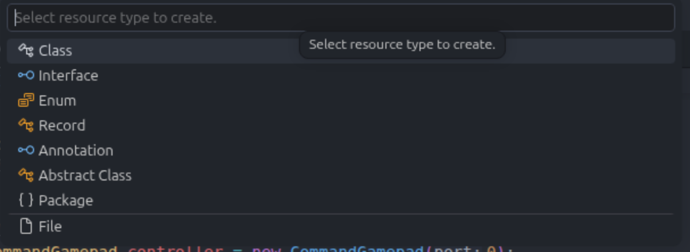
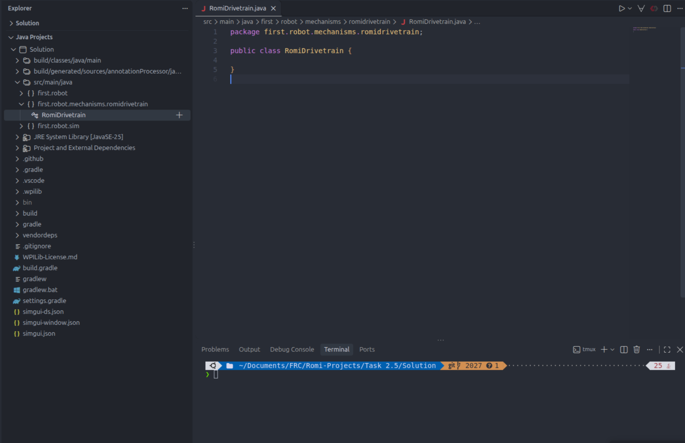

# Task 2.5: Creating a Subsystem

You'll build: The RomiDrivetrain template you used in Task 1.

**Time:** about 1 hour · **Need:** Nothing, but finishing Task 1 and Task 2 will help you build intuition.

> [!TIP]
> Stuck? Each step has a finished copy in [`checkpoints/`](checkpoints).

---

## Step 1: Create the Subsystem File

To start the process of creating a subsystem, first create a file for it. You should use the `Java Projects` view over the normal Explorer view since it groups by package and allows you to create Java files directly.

Create a new file by clicking on the plus on the `first.robot.mechanisms` package.

 

Then select `Class`

 

It will prompt you to name your new class. Call it `RomiDrivetrain`. Pressing enter should take you to a new blank class like below.

 

Next, we must implement `Mechanism`. All robot mechanisms (aka subsystems) must implement this interface. To implement simply add `implements Mechanism` after `RomiDrivetrain` like so:

```java
public class RomiDrivetrain implements Mechanism {

}
```

>[!TIP]
>`Mechanism` is located in the package `org.wpilib.command3`. We have to add the import to use it, but VSCode will suggest it as we type. Press [enter] to take the suggestion and VSCode will automatically add the needed import.

## Step 2: Declaring Hardware Components

Every subsystem you will ever create is made up of hardware components. We can broadly classify hardware components as:
- Actuators - Hardware components that allow physical interaction with the world
  
| Type        | Motion produced | How it works                                                                                                                                    |
| ----------- | -------------- | ----------------------------------------------------------------------------------------------------------------------------------------------- |
| Motor | Circular rotation | An electrical voltage applied across the motors terminals generate internal magnetic fields that cause a central shaft to start spinning until it reaches a speed proportional to the voltage applied. |
| Servo | Rotation to a position | A more specialized motor that can precisely turn to specific positions that have been electrically marked. Cannot continuously turn like a normal motor.
| Pneumatic Piston | Linear motion between two points | Compressed air is used to either extend or retract a piston |
 
- Sensors - Hardware components that give information about the physical world


| Type        | What is senses | How it works                                                                                                                                    |
| ----------- | -------------- | ----------------------------------------------------------------------------------------------------------------------------------------------- |
| Encoder     | Rotational position       | Marked "ticks" along it count the amount of rotation like marks on a clock as the hands turn. Typically used to measure how much a motor turns. |
| String potentiometer | Linear position | A tether that, when pulled, turns a dial whose resistance changes as it is turned. |
| Gyro(scope) | Orientation    | Tiny vibrating masses inside the device along with microscopic force sensors detect angular motion and relative to a starting position.         |
| Camera | Position + Orientation            | Uses the known geometry of objects with the way they appear in a frame of a video to estimate the position and orientation of an object relative to the position of the camera |
| Limit switch | Binary position | A small lever switch that emits a signal when it is held down. Used to detect when a mechanism is at some mechanical limit we don't want it to surpass. |
| Line break sensor | Binary position | Uses a beam of light to detect if an object has passed in front of it. Often used to tell if an actuator has "grabbed" some object. |

Now let's think about what actuators and sensors are available to the drivetrain:
- Actuators:
  - 2 DC motors, one for each side (`RomiMotor`)
- Sensors:
  - 2 encoders, one for each motor (`Encoder`)
  - 1 gyro(scope) (`RomiGyro`)

Now we list these components in the subsystem's class. Components should be marked `protected final`. Make sure you give your components descriptive names and not just `component`. Someone should be able to look at the variable's name and figure out which physical part of the robot that it corresponds to (e.g. `frontLeftMotor`).

The types for the hardware components are:

```java
public class ExampleMechanism implements Mechanism {
    protected final ExampleComponentType component;
}
```

>[!TIP]
> You can declare multiple variables of the same type at once like so:
> ```java 
> public class ExampleMechanism implements Mechanism {
>    protected final ExampleComponentType component1, component2;
>}
>```

>[!NOTE]
> Java types are typically in PascalCase while variables are in camelCase. In PascalCase the first letter of every word is capitalized. camelCase is similar, except the first word is always entirely lowercase. Try to follow these guidelines to keep your code readable.

<details>
<summary> Solution </summary> 

```java
public class RomiDrivetrain implements Mechanism {
    protected final RomiMotor leftMotor, rightMotor;
    protected final Encoder leftEncoder, rightEncoder;
    protected final RomiGyro gyro;
}
```
</details>

## Step 3: Creating the constructor

A class's *constructor* defines how to create objects of its type. It is a special function that shares the name of the class and should be marked `public`.  Every mechanism's constructor must take in the components we just defined and initialize them. For example:

```java
public class ExampleMechanism implements Mechanism {
    protected final ExampleComponentType component1, component2;

    public ExampleMechanism(ExampleComponentType component1, ExampleComponentType component2) {
        this.component1 = component1;
        this.component2 = component2;
    }
}
```

>[!NOTE]
> The Java keyword `this` solves naming conflicts. Inside the `ExampleMechanism` constructor,
> there are two variables named `component1`. One is an input to the constructor function, and one
> is a property of the class we wish to initialize. `this` allows us to refer to the one in the class unambiguously.

>[!WARNING]
>The comma syntax for declaring multiple variables of the same type doesn't work for inputs to a function. Notice how I still had to write `ExampleComponent` twice in the constructor's input list.

<details>
<summary> Solution </summary> 

```java
public class RomiDrivetrain implements Mechanism {
    protected final RomiMotor leftMotor, rightMotor;
    protected final Encoder leftEncoder, rightEncoder;
    protected final RomiGyro gyro;

    public RomiDrivetrain(RomiMotor leftMotor, RomiMotor rightMotor, Encoder leftEncoder, Encoder rightEncoder, RomiGyro gyro) {
        this.leftMotor = leftMotor;
        this.rightMotor = rightMotor;

        this.leftEncoder = leftEncoder;
        this.rightEncoder = rightEncoder;
        
        this.gyro = gyro;
    }
}
```
</details>


## Step 4: Mapping Constants

Every subsystem usually has a list of associated constants, usually containing at least, the ports where actuators and sensors are plugged into the robot controller. We'll need to create a file that stores these. 