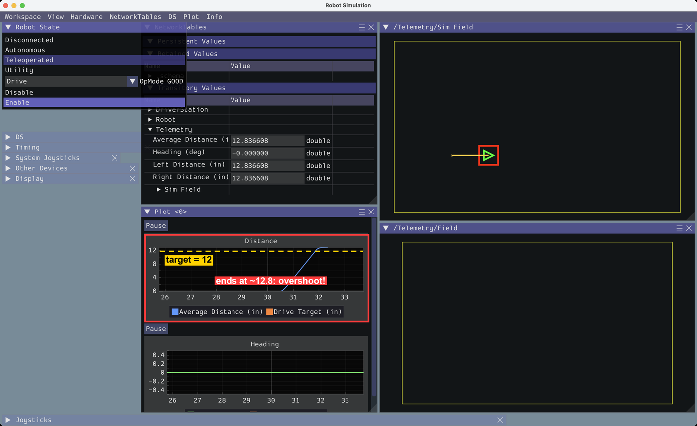
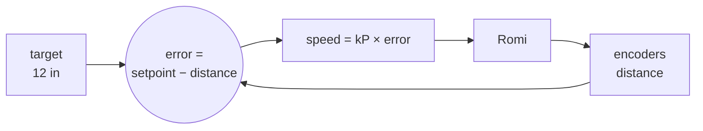
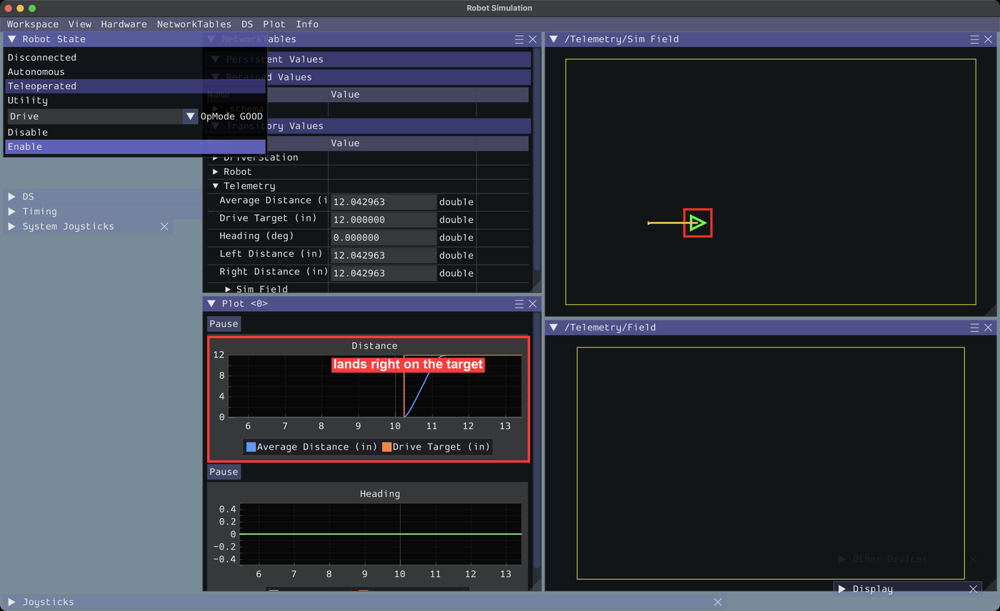
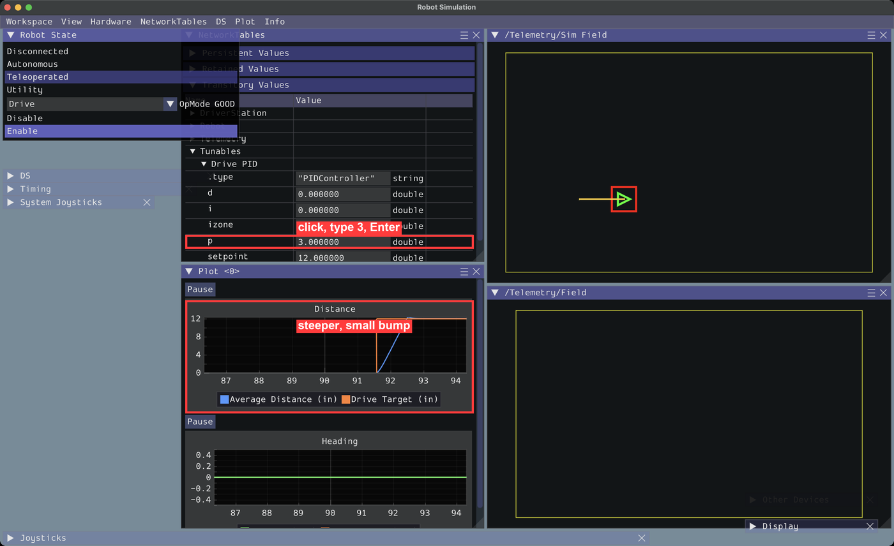
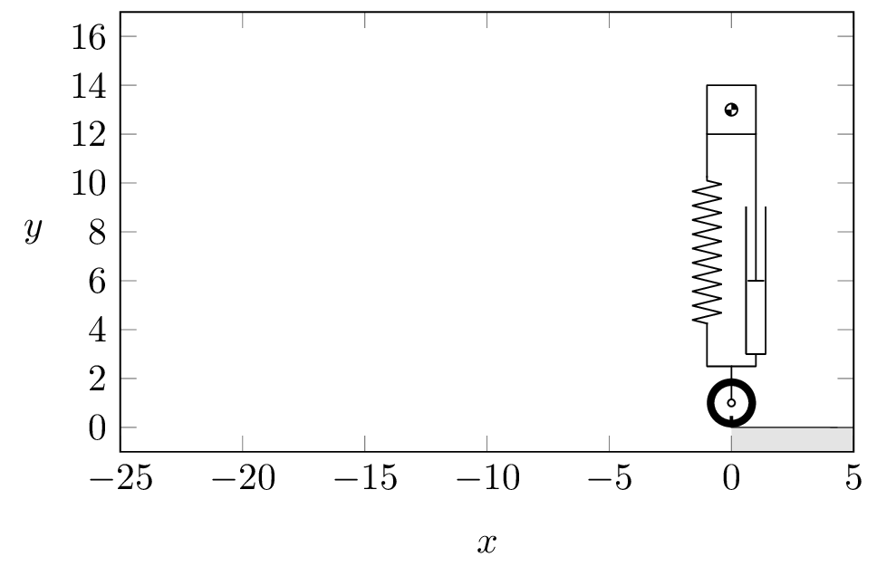
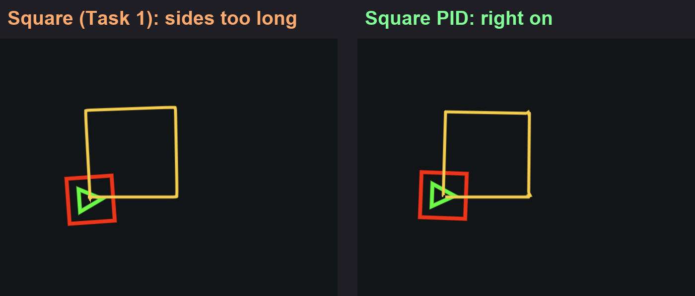

# Task 2: PID (Stop Right on Target)

**You'll build:** drive and turn commands that slow down and stop *exactly* on target, plus a square that's actually square.

**Time:** about 1 hour · **Need:** your finished [Task 1](../Task%201/README.md) project (or copy [`Task 2/Template`](Template)).

> [!TIP]
> Stuck? Each step has a finished copy in [`checkpoints/`](checkpoints).

---

## Step 1: See the problem

In Task 1, we fixed the `driveForward()` overshoot when it stopped *after* it passes 12 by changing it so that it stops before 12, but saw that the amount you need to stop early by changes when you go faster, but also is most accurate when you move *very slowly*. We will now show you a better method using *feedback control*. Feedback control works by using information about where we're at to adjust our output (think about the robot receiving "feedback" about how close it is getting to its target).

### Terms to know
| Word             | Means                                                                                                     |
| ---------------- | --------------------------------------------------------------------------------------------------------- |
| Setpoint         | The target value for a control system.                                                                    |
| Overshoot        | (The amount) a control system goes over the setpoint.                                                     |
| Undershoot       | (The amount) a control system goes under the setpoint.                                                    |
| Error            | The difference between a control system's current value and its setpoint                                  |
| Feedback control | A method of control that uses information about the error to drive a control system to a setpoint |

> ### ✅ Checkpoint 1: See the overshoot
> 1. Reset `kDefaultDriveSpeed` to 0.4 and delete any overshoot correction you may have done.
> 2. **Simulate Robot Code** → **Teleoperated** → **Drive** → **Enable**.
> 3. Press **Z** and watch the **Distance** graph (already set up in the **Plot** window).
> 4. The line goes up and ends at about **13**, not 12.
>
> 
>
> Graph looks flat or off-screen? Double-click it to re-fit.

## The fix: P(roportional) control

We should automatically slow down as we get closer to the setpoint so that we don't overshoot. We can do this using a type of feedback control called *P control*, outlined below. It's called that because our output is *proportional* to our error. 



| Error (inches left) | Speed with kP = 0.2                    |
| ------------------- | -------------------------------------- |
| 12                  | 2.4 → capped at our max speed, **0.6** |
| 2                   | **0.4**                                |
| 0.5                 | **0.1**                                |
| 0                   | **0** (stop)                           |

That's the **P** in PID. We will learn more about the **I** and **D** terms later. Leave them at 0 for now.

---

## Step 2: PID drive

### 2a. Add these to `Constants.java` (inside `DriveConstants`, under `kTurnStopEarlyDegrees`)

```java
    // Drive PID
    public static final double kDriveP = 0.1;
    public static final double kDriveI = 0;
    public static final double kDriveD = 0;
    public static final double kDriveToleranceInches = 0.5; // "close enough"
    public static final double kDriveSpeedToleranceInchesPerSec = 1; // "almost stopped"
    public static final double kMaxDrivePIDSpeed = 0.6;
```

### 2b. In `RomiDrivetrain.java`, add the imports (skip any VS Code already added)

```java
import static org.wpilib.units.Units.Seconds; // place next to other "import static" line
import org.wpilib.math.controller.PIDController;
import org.wpilib.tunable.Tunables;
```

### 2c. Add the PID controller (below `diffDrive`)

```java
  private final PIDController drivePID = new PIDController(kDriveP, kDriveI, kDriveD);
```

### 2d. At the end of the constructor `RomiDrivetrain() { ... }`

```java
    drivePID.setTolerance(kDriveToleranceInches, kDriveSpeedToleranceInchesPerSec);
    Tunables.publish("Drive PID", drivePID); // lets you change P, I, D live in the sim window
```

### 2e. driveForwardPID()

Use WPILib's `PIDController` to drive forward using P control. This time, instead of us showing you how to use it, you will learn how yourself by reading WPILib's *documentation*. Documentation is like a manual for some code that someone else has written. It will become important for you to understand how to read *documentation* so that you can find information yourself. 

[Link to WPILib Documentation](https://github.wpilib.org/allwpilib/docs/beta/java/index.html). Search up `PIDController`.


```java
  /** Drives forward a distance using PID, so it slows down and stops right on target. */
  public Command driveForwardPID(double inches) {
    return run(coroutine -> {

          // 1. Calculate the setpoint by adding the target to the current distance.

          // 2. Reset the PID Controller.
          // 3. Set the PID Controller's setpoint.

          while (/*4. Check stop condition*/) {

            // 5. Calculate the output using the PID Controller
            // 6. Clamp the output between -1 and 1 using Math.clamp()
            // 7. Drive forward using arcadeDrive();


            // 8. Log the error and setpoint using Telemetry.log()
            // as "Drive Setpoint (in)" and "Drive Error (in)"

            coroutine.yield();
          }

          // 8. Stop the motors using stop()
        })
        .named("Drive Forward PID")
        .withTimeout(Seconds.of(3)); // give up after 3 seconds, just in case
  }
```

> [!WARNING]
> **Setting a timeout**
> Safe code always sets a timeout. When things don't go according to plan, you should always have a backup plan or else the robot can keep going and do something dangerous.


> [!TIP]
> **Getting started with documentation**
> You may find the following function in PIDController useful: `reset()`. Try to find other functions that do what we're looking to do. Don't be afraid to ask for help if you need it. CTRL+F (or Cmd+F) is your friend.


<details>
<summary> Solution </summary> 

```java
public Command driveForwardPID(double inches) {
  return run(coroutine -> {
        double setpoint = getAverageDistanceInches() + inches;
        drivePID.reset();
        drivePID.setSetpoint(setpoint);

        while (!drivePID.atSetpoint()) {
          double speed = drivePID.calculate(getAverageDistanceInches());
          speed = Math.clamp(speed, -kMaxDrivePIDSpeed, kMaxDrivePIDSpeed);
          arcadeDrive(speed, 0);

          Telemetry.log("Drive Setpoint (in)", setpoint);
          Telemetry.log("Drive Error (in)", setpoint - getAverageDistanceInches());
          
          coroutine.yield();
        }

        stop();
      })
      .named("Drive Forward PID")
      .withTimeout(Seconds.of(3)); // give up after 3 seconds, just in case
}
```

| Line                    | Means                                                               |
| ----------------------- | ------------------------------------------------------------------- |
| `setSetpoint(setpoint)` | Where we want to end up                                             |
| `calculate(distance)`   | Gives a speed: `kP × (setpoint − distance)`                           |
| `Math.clamp(...)`       | Stay between `-kMaxDrivePIDSpeed` and `kMaxDrivePIDSpeed`           |
| `atSetpoint()`          | `true` when error and speed is within the set tolerance.           |

</details> <br>


### 2f. Use it on the Z button (in `DriveTeleop.java`, change the `faceDown` line)

```java
    // Z button: drive forward 12 inches with P(ID) control
    controller.faceDown().onTrue(drivetrain.driveForwardPID(12));
```

> ### ✅ Checkpoint 2
> Press **Z**. On the **Distance** graph, the **Drive Setpoint** line jumps to the setpoint.
>
> The distance line curves up and **flattens right on the target line**, at about 12.0.
>
> 

---

## Step 3: Tune it

Changing the value of kP adjusts how aggressive the P controller becomes.

>### Try it yourself.
> In the **NetworkTables** window, under **Transitory Values**, open **Tunables → Drive PID** (collapse **Telemetry** if you can't see it). Click the number next to **p**, type a new value, press **Enter**. Then press **Z** again and watch the graph.
>
>| kP       | What you'll see                                      |
>| -------- | ---------------------------------------------------- |
>| **0.02** | Too slow. Stops around 8–9 in, gives up after 3 s. |
>| **3**    | Too jumpy. Shoots past 12, then backs up.          |

> ### ✅ Checkpoint 3
> You saw all three behaviors on the plot.
>
> When you find a value you like, **put it in `Constants.java`**. Live changes are lost when the sim restarts.
> 


Now it's your turn. Try tuning the P value so that it's not too slow nor too jumpy.

> [!WARNING]
> **Always start small**
> Large values are jumpy which can be dangerous for larger robots and strong mechanisms (think of a 120 lb robot jittering instead of a small Romi). Moreover, this behavior introduces large forces for any control system and can damage it (this has happened more than once...)


> [!NOTE]
> **Motor Stalling and Deadband**
> For low values of kP, the motor stalls. The motor cannot 
> output very small requested values because it has internal friction that keeps it from turning
> at low power. All motors have a *deadband*, a range of values too small for them to output.

> [!TIP]
> **Tuning Values with Binary Search**
> Try averaging a value that is too much and a value that is too small. If the new value is too large, average it again with a smaller value you've tried. If it's too small, average it with a larger value you've tried. For example, we might average 3 and 0.02 to get ~1.5. If 1.5 is too high, we average it again with 0.02. If it's too low, we average it with 3. This way, you get closer by half each time and your search space decreases by half each time. This method is called *binary search*.

<details>
<summary> Solution </summary> 

`kP = 0.2`

</details> <br/>


---

## Step 4: P(roportional) D(erivative) turn

### 4a. `Constants.java` (under the drive PID constants)

Adding the D term adds damping to the system. The D stands for "derivative". You may not have heard of this term before but you can think about this term as adding "damping". One way I like to visualize a PD controller is as a "virtual" spring mass damper like below.



Let's get started. Add these constants to `src/main/java/first/robot/Constants.java`.

```java
    // Turn PID
    public static final double kTurnP = 0.03;
    public static final double kTurnI = 0;
    public static final double kTurnD = 0.002; // a little D stops the turn from wobbling
    public static final double kTurnToleranceDegrees = 2;
    public static final double kTurnSpeedToleranceDegreesPerSec = 5;
    public static final double kMaxTurnPIDSpeed = 0.3;
```

### 4b. `RomiDrivetrain.java`: a second controller (below `drivePID`)

```java
  private final PIDController turnPID = new PIDController(kTurnP, kTurnI, kTurnD);
```

At the end of the constructor:

```java
    turnPID.setTolerance(kTurnToleranceDegrees, kTurnSpeedToleranceDegreesPerSec);
    Tunables.publish("Turn PID", turnPID);
```

### 4c. Complete the command (below `turnLeft`). It's the same pattern as `driveForwardPID()` using heading instead of distance.

```java
/** Turns left (counter-clockwise) some degrees using PID. Negative degrees turn right. */
public Command turnLeftPID(double degrees) {
  return run(coroutine -> {
        // Complete me
      })
      .named("Turn Left PID")
      .withTimeout(Seconds.of(3));
}
```

<details>
<summary> Solution </summary> 

```java
public Command turnLeftPID(double degrees) {
  return run(coroutine -> {
        double setpoint = getHeadingDegrees() + degrees;
        turnPID.reset();
        turnPID.setSetpoint(setpoint);

        while (!turnPID.atSetpoint()) {
          double speed = turnPID.calculate(getHeadingDegrees());
          speed = Math.clamp(speed, -kMaxTurnPIDSpeed, kMaxTurnPIDSpeed);
          arcadeDrive(0, speed);

          Telemetry.log("Turn Setpoint (deg)", setpoint);
          Telemetry.log("Turn Error (deg)", setpoint - getHeadingDegrees());
          coroutine.yield();
        }

        stop();
      })
      .named("Turn Left PID")
      .withTimeout(Seconds.of(3));
```
</details>

### 4d. `DriveTeleop.java`: change the `faceRight` line

```java
    // B button (X on the keyboard): turn left 90 degrees with PID
    controller.faceRight().onTrue(drivetrain.turnLeftPID(90));
```

> ### ✅ Checkpoint 4
> Press **X** and watch the **Heading** graph.
>
> Heading lands on the target, within about 1°, with **no** stop-early guess needed.

---

## Step 5: A real square

Create a new file **`opmodes/SquarePIDAuto.java`** (like Task 1 Step 2b). It's quite similar to the square auto we already did. Do you think you can do it from scratch this time? As a robot programmer, you should start to get familiar as you will be using `OpMode`s and `Command`s quite a bit. Try to do it without looking back from memory. Only look back if you really can't figure out. Remember, struggling is part of what helps you remember. The solution is right below but you're only cheating yourself.

```java
package first.robot.opmodes;

import first.robot.Robot;
import org.wpilib.command3.Command;
import org.wpilib.command3.Scheduler;
import org.wpilib.opmode.Autonomous;
import org.wpilib.opmode.OpMode;

/** Shows up as "Square PID" in the Autonomous list of the sim window. */
@Autonomous(name = "Square PID")
public class SquarePIDAuto implements OpMode {
  // Complete me
}
```


<details>
<summary> Solution </summary> 

```java
package first.robot.opmodes;

import first.robot.Robot;
import org.wpilib.command3.Command;
import org.wpilib.command3.Scheduler;
import org.wpilib.opmode.Autonomous;
import org.wpilib.opmode.OpMode;

/** Shows up as "Square PID" in the Autonomous list of the sim window. */
@Autonomous(name = "Square PID")
public class SquarePIDAuto implements OpMode {
  private final Robot robot;

  public SquarePIDAuto(Robot robot) {
    this.robot = robot;
  }

  /** Runs once when the robot is enabled. */
  @Override
  public void start() {
    var drivetrain = robot.drivetrain;

    Command square =
        Command.noRequirements(coroutine -> {
              for (int side = 0; side < 4; side++) {
                coroutine.await(drivetrain.driveForwardPID(12)); // run it and wait until it's done
                coroutine.await(drivetrain.turnLeftPID(90));
              }
            })
            .named("Square PID");

    Scheduler.getDefault().schedule(square);
  }
}
```

</details>


> ### ✅ Checkpoint 5: Race them!
> Restart the sim. Run **Autonomous → Square**, then restart and run **Autonomous → Square PID**.
>
> | | Square (Task 1) | Square PID |
> |---|---|---|
> | **Average Distance** at the end (4 × 12 = 48) | ~51 😬 | ~48 ✅ |
> | **Heading** goes up by (4 × 90 = 360) | ~364 | ~358 |
> | Still works if you change speed or battery? | no, you'd need to re-measure | yes ✅ |
>
> 

---

## End of Task 2

| You learned                                     | Code                                |
| ----------------------------------------------- | ----------------------------------- |
| P control: speed grows with error               | `new PIDController(kP, kI, kD)`     |
| PD control: speed grows with error, damped by D | `new PIDController(kP, kI, kD)`     |
| When to stop                                    | `setTolerance(...)`, `atSetpoint()` |
| Speed limits                                    | `Math.clamp(...)`                   |
| Live tuning                                     | `Tunables.publish(...)`             |
| Safety timeout                                  | `.withTimeout(Seconds.of(3))`       |

### Challenges (optional)
Answers (tested in the sim) are in [`challenges/`](challenges) — try first!

- Put `driveForwardPID(-12)` on the **Y** button (**V** key). Do you need to change any PID code? Why or why not?
- On a **real Romi**, re-tune `kDriveP` and `kTurnP`. Real motors aren't the same as the sim's.

**Next:** [Task 3: Odometry & Paths](../Task%203/README.md)

<details>
<summary>❌ Something's wrong?</summary>

| Problem                                          | Fix                                                                 |
| ------------------------------------------------ | ------------------------------------------------------------------- |
| `Math.clamp` not found                           | You need Java 21+. Use the WPILib 2027 VS Code.                     |
| Command never ends (Romi sits still near target) | kP is too small to beat friction. Raise kP, or raise the tolerance. |
| Romi shakes back and forth                       | kP too big → lower it, or add a little D.                           |
| No **Tunables** folder                           | Did you add `Tunables.publish(...)` to the constructor?             |

</details>
